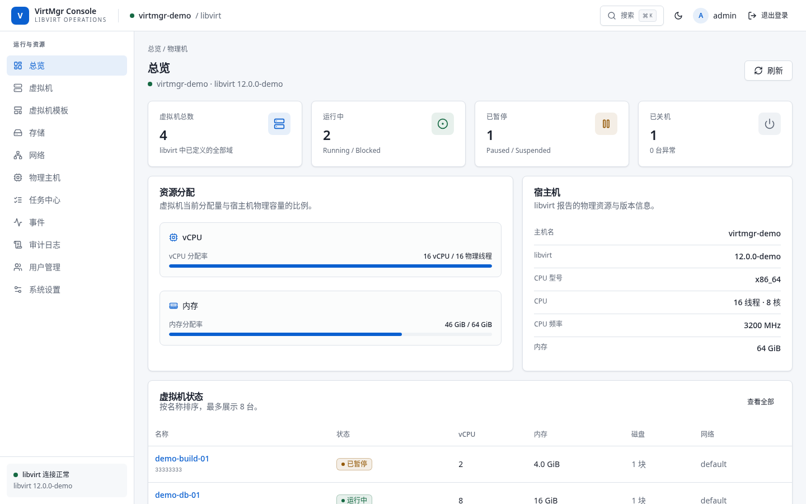
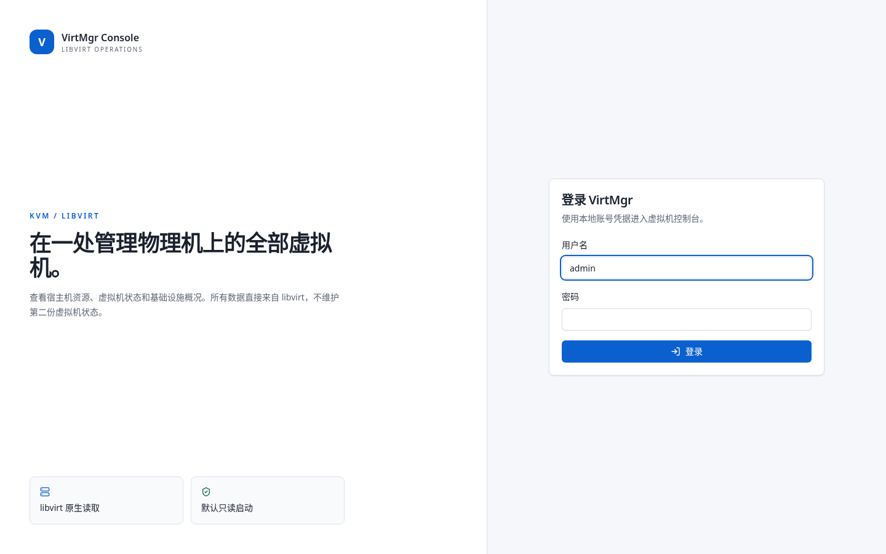
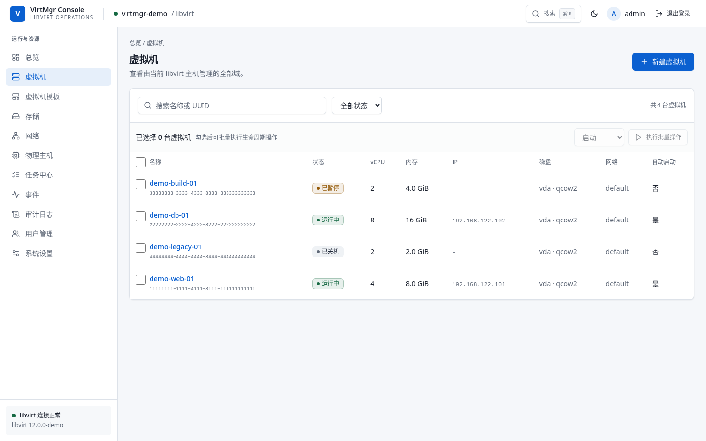
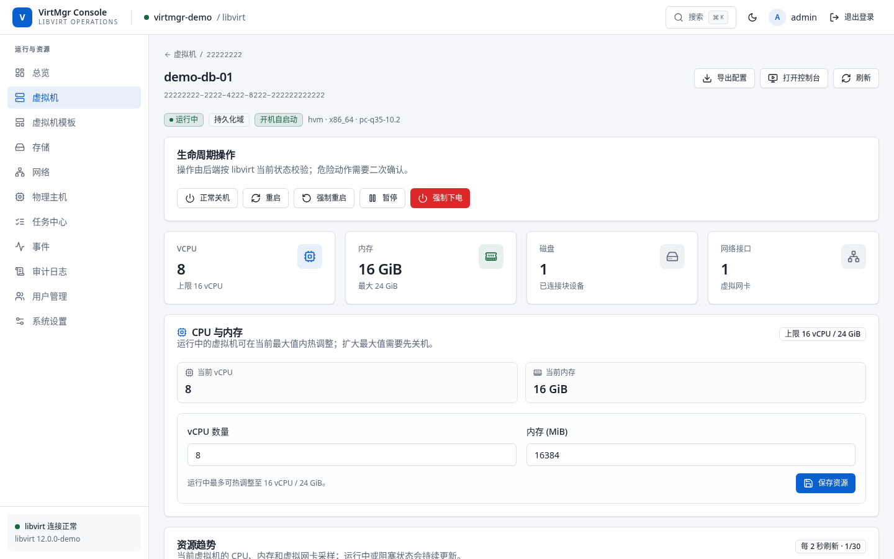
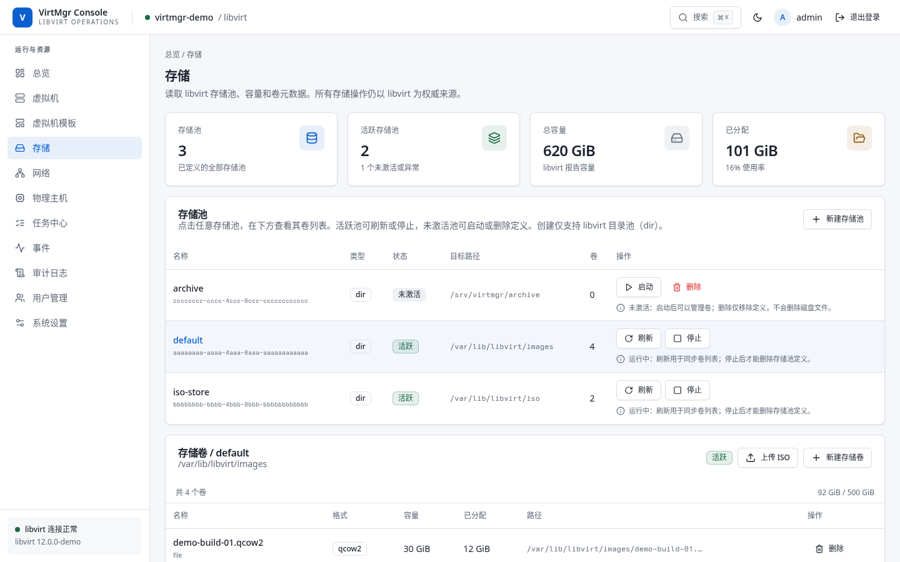
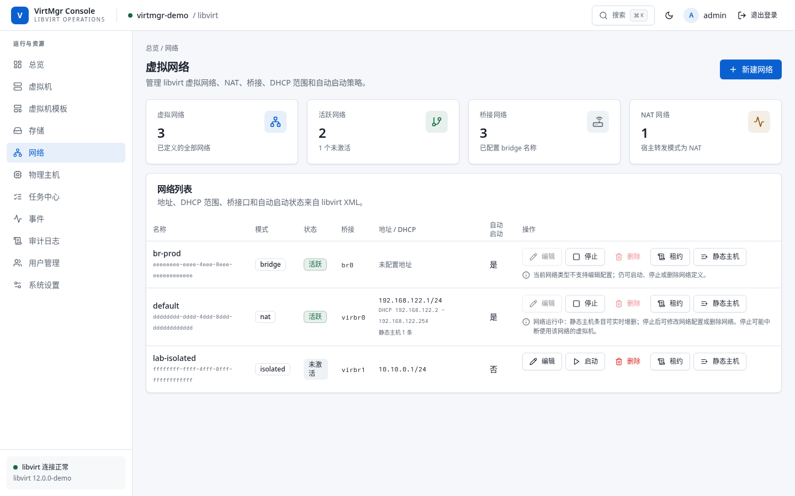

<div align="center">
  <h1>VirtMgr</h1>
  <p><strong>A lightweight web console for managing KVM/libvirt virtual machines.</strong></p>
  <p>VirtMgr exposes host health, virtual machine lifecycle operations, storage, networking, snapshots, VNC consoles, audit logs, and long-running tasks from a single self-hosted web application.</p>
  <p>
    <a href="#screenshots">Screenshots</a> ·
    <a href="#feature-overview">Features</a> ·
    <a href="#quick-start">Quick start</a> ·
    <a href="#configuration">Configuration</a> ·
    <a href="#authentication-and-permissions">Permissions</a> ·
    <a href="#development-and-testing">Development</a> ·
    <a href="README.zh-CN.md">简体中文</a>
  </p>
  <p>
    <a href="LICENSE"></a>
    <a href="https://github.com/xuthus5/virtmgr/actions/workflows/release.yml"></a>
    <a href="https://github.com/xuthus5/virtmgr/releases/latest"></a>
    
    
  </p>
  
</div>

## What is VirtMgr?

VirtMgr is a self-hosted management console for a single KVM/libvirt host. It is designed for home labs, single-server private clouds, and teams that want a practical browser-based alternative to repeated `virsh` commands.

libvirt remains the source of truth for virtual machines, storage pools, networks, snapshots, and host resources. SQLite is only used for local users, sessions, templates, snapshot policies, tasks, runtime settings, and audit records. VirtMgr does not maintain a second copy of VM state.

The application ships as one Go binary with the React frontend embedded through `go:embed`. It connects directly to the libvirt socket, supports native TLS or TLS termination by a reverse proxy, and runs cleanly as a systemd service.

## Screenshots

All screenshots use the built-in demo backend, not production host data.

| Sign in | Overview |
|---|---|
|  |  |

| Virtual machines | VM details |
|---|---|
|  |  |

| Storage pools and volumes | Virtual networks |
|---|---|
|  |  |

## Feature overview

| Area | Capabilities |
|---|---|
| Overview | Host CPU, memory, libvirt version, VM counts, allocation ratios, warnings, and recent VM status |
| Virtual machines | Search and filter domains; view state, vCPU, memory, disk, network, IP, and autostart; perform single or batch lifecycle actions |
| VM creation | BIOS/UEFI, Secure Boot, existing or manual disk, network selection, ISO, autostart, and optional Cloud-init seed ISO |
| VM details | Hardware summary, live CPU/memory/network trends, disks, NICs, Guest Agent information, snapshots, and domain XML |
| Console | Browser-based noVNC console through a one-time token and server-side WebSocket proxy; the VNC port is never exposed directly |
| VM operations | Start, graceful shutdown, reboot, reset, pause, resume, force off, delete, clone, cold backup, autostart, CPU/memory adjustment, and disk expansion |
| Domain XML | Read live or persistent XML in CodeMirror; admins can validate and edit the persistent configuration in writable mode |
| Snapshots | Create, revert, delete, and schedule per-VM snapshots with retention policies |
| Storage | Manage directory pools; start, stop, refresh, and delete definitions; create qcow2/raw volumes; upload ISOs; protect in-use volumes |
| Networking | NAT and isolated networks, bridge details, IPv4/DHCP configuration, live leases, static DHCP hosts, create/edit/start/stop/delete |
| Host devices | PCI, USB, network, block, and DRM device inventory with PCI/USB passthrough attach and detach |
| Observability | SSE event stream, task center with progress and failures, host and VM resource trends, structured logs, health endpoints |
| Security | Local accounts, Argon2id passwords, HttpOnly/SameSite cookies, CSRF protection, role-based access, global read-only mode, audit trail, CSP and security headers |
| User experience | Responsive layout, light/dark themes, keyboard-friendly global search, accessible dialogs, and explicit confirmation for destructive actions |
| Templates | Reusable VM specifications, firmware/network defaults, and Cloud-init defaults without instance names or disk paths |

## Architecture

```text
Browser
  │ HTTPS
  ▼
React + TypeScript + Vite
  │ REST / SSE / WebSocket
  ▼
Go HTTP server and domain modules
  ├── libvirt Go binding ──► libvirtd / QEMU-KVM
  ├── modernc.org/sqlite ──► users, sessions, tasks, audit, templates, policies
  └── libvirt event loop ──► SSE event stream
```

The frontend is compiled into the Go binary, so production deployment does not require a separate web server. The backend follows an `http → app → domain` dependency direction, with infrastructure adapters under `internal/platform`.

See [docs/architecture-design.md](docs/architecture-design.md) for the detailed design, data model, route map, and operational boundaries. The design document is currently written in Chinese.

## Quick start

### Prerequisites

- Linux host with KVM/QEMU and libvirt
- Go `1.26+`
- Node.js `24+` and npm
- A C compiler, `pkg-config`, and libvirt development headers because the libvirt Go binding uses CGO
- A Unix socket reachable through `qemu:///system`, normally `/var/run/libvirt/libvirt-sock`

On Fedora-based hosts, a typical development setup is:

```bash
sudo dnf install -y gcc make pkg-config libvirt libvirt-devel qemu-kvm
sudo systemctl enable --now libvirtd
```

Package names differ across distributions. Ensure that `libvirt-dev` or `libvirt-devel`, QEMU/KVM, and the libvirt daemon are installed before building.

### Build from source

```bash
git clone git@github.com:xuthus5/virtmgr.git
cd virtmgr

npm --prefix web ci
make build

./bin/virtmgr version
```

`make build` builds the React frontend first, embeds it into the binary, and produces `bin/virtmgr`.

### Run the demo backend

The demo mode uses a libvirt fixture backend and does not require a running libvirt service. It is intended for UI review and development only.

```bash
VIRTMGR_DEMO_MODE=true \
VIRTMGR_DATABASE_PATH=/tmp/virtmgr-demo.db \
VIRTMGR_ADMIN_PASSWORD='change-this-password' \
VIRTMGR_READ_ONLY=false \
./bin/virtmgr
```

Open <http://127.0.0.1:8443> and sign in with `admin` and the password configured above.

### Frontend development

Run the Go API and Vite development server in separate terminals:

```bash
VIRTMGR_ADMIN_PASSWORD='dev-password' VIRTMGR_READ_ONLY=false go run ./cmd/virtmgr
```

```bash
cd web
npm run dev
```

Vite serves the UI on <http://127.0.0.1:5173> and proxies `/api`, `/healthz`, and `/readyz` to the Go server on port `8443`.

## Deploy as a systemd service

### 1. Install the binary and service account

```bash
sudo useradd --system --home /var/lib/virtmgr --shell /sbin/nologin --groups libvirt virtmgr
sudo install -d -o virtmgr -g virtmgr -m 0750 /var/lib/virtmgr
sudo install -d -o root -g virtmgr -m 0750 /etc/virtmgr

sudo install -m 0755 bin/virtmgr /usr/local/bin/virtmgr
sudo install -m 0640 -o root -g virtmgr deploy/virtmgr.env.example /etc/virtmgr/virtmgr.env
sudo install -m 0644 deploy/virtmgr.service /etc/systemd/system/virtmgr.service
```

If the service account already exists, adjust the `useradd` command rather than recreating it.

### 2. Configure the environment

Edit `/etc/virtmgr/virtmgr.env`:

```dotenv
VIRTMGR_LISTEN=127.0.0.1:8443
VIRTMGR_LIBVIRT_URI=qemu:///system
VIRTMGR_DATABASE_PATH=/var/lib/virtmgr/virtmgr.db
VIRTMGR_HOST_NAME=virt-host-01
VIRTMGR_ADMIN_USERNAME=admin
VIRTMGR_ADMIN_PASSWORD=replace-with-a-strong-password
VIRTMGR_SESSION_TTL=8h
VIRTMGR_COOKIE_SECURE=false
VIRTMGR_READ_ONLY=true
VIRTMGR_DEMO_MODE=false
```

`VIRTMGR_ADMIN_PASSWORD` is only used when the database has no users. After the first successful start, remove the plaintext password from the environment file. Keep the file readable only by root and the `virtmgr` group.

### 3. Start and verify

```bash
sudo systemctl daemon-reload
sudo systemctl enable --now virtmgr
sudo systemctl status virtmgr --no-pager

curl -fsS http://127.0.0.1:8443/healthz
curl -fsS http://127.0.0.1:8443/readyz
```

Follow logs with:

```bash
sudo journalctl -u virtmgr -f
```

### HTTPS and reverse proxies

VirtMgr supports HTTPS in two ways:

**Native TLS**

```dotenv
VIRTMGR_LISTEN=0.0.0.0:8443
VIRTMGR_TLS_CERT_FILE=/etc/virtmgr/tls/fullchain.pem
VIRTMGR_TLS_KEY_FILE=/etc/virtmgr/tls/privkey.pem
VIRTMGR_COOKIE_SECURE=true
```

Both TLS files must be configured together. Restrict the private key to the service account.

**TLS termination by nginx, Caddy, or a tunnel**

Keep VirtMgr bound to `127.0.0.1:8443`, proxy all application paths, preserve WebSocket upgrades for the VNC console, and set `VIRTMGR_COOKIE_SECURE=true` whenever the browser accesses the service over HTTPS.

Do not expose a writable VirtMgr instance directly to the public internet without TLS, a firewall, and a strong administrator password.

## Configuration

| Variable | Default | Description |
|---|---|---|
| `VIRTMGR_LISTEN` | `127.0.0.1:8443` | HTTP/HTTPS listen address |
| `VIRTMGR_TLS_CERT_FILE` | empty | PEM certificate chain for native TLS; must be set with the key |
| `VIRTMGR_TLS_KEY_FILE` | empty | PEM private key for native TLS; must be set with the certificate |
| `VIRTMGR_LIBVIRT_URI` | `qemu:///system` | libvirt connection URI |
| `VIRTMGR_DATABASE_PATH` | `/var/lib/virtmgr/virtmgr.db` | SQLite database path |
| `VIRTMGR_HOST_NAME` | OS hostname | Display name for the managed host |
| `VIRTMGR_ADMIN_USERNAME` | `admin` | Initial administrator username when the user table is empty |
| `VIRTMGR_ADMIN_PASSWORD` | unset | Initial administrator password; required only for the first start |
| `VIRTMGR_SESSION_TTL` | `8h` | Login session lifetime; must be a positive Go duration |
| `VIRTMGR_COOKIE_SECURE` | `false` | Mark the session cookie as `Secure`; enable it for HTTPS deployments |
| `VIRTMGR_READ_ONLY` | `true` | Initial global write-protection state |
| `VIRTMGR_DEMO_MODE` | `false` | Use the demo backend for UI development; never enable this in production |

Changes to the database, libvirt connection, or TLS paths require a service restart. The read-only mode can also be changed at runtime from the admin settings page and is persisted in SQLite.

## Authentication and permissions

VirtMgr uses local accounts. Passwords are hashed with Argon2id, sessions are stored as hashes in SQLite, and the browser receives only an `HttpOnly` and `SameSite=Strict` session cookie. Every state-changing API request requires the session's CSRF token in `X-CSRF-Token`.

| Role | Read access | VM lifecycle and create/clone/backup | Snapshots, storage, networks, templates | VNC console | Edit domain XML | Users, settings, audit |
|---|---:|---:|---:|---:|---:|---:|
| `viewer` | Yes | No | No | No | No | No |
| `operator` | Yes | Yes | Yes | Yes | No | No |
| `admin` | Yes | Yes | Yes | Yes | Yes | Yes |

The global read-only mode blocks all mutating infrastructure operations regardless of role. Read-only inventory, domain XML viewing, configuration export, and metric/event queries remain available.

Administrators can create users, change roles, disable accounts, inspect the audit log, and change the persisted read-only setting from the web UI.

## Safety and operational behavior

- **Libvirt is authoritative.** VirtMgr does not store a second VM inventory and degrades explicitly when libvirt is unavailable.
- **Destructive operations require confirmation.** Force off, reset, snapshot revert, volume deletion, and VM deletion use explicit dialogs; some delete flows require typing the resource name.
- **Long-running work becomes a task.** ISO uploads, cloning, and cold backups expose progress, steps, failures, and related resources through the task center.
- **Cold backups are not restores.** A backup contains the persistent domain XML, a SHA-256 manifest, and writable file disks, but not RAM state. Restore is not currently provided.
- **Disk expansion does not resize guest partitions.** VirtMgr grows the qcow2/raw virtual disk only. Linux guests may still need `growpart` plus `resize2fs`/`xfs_growfs`; Windows guests require volume expansion in Disk Management. Shrinking is not supported.
- **CPU and memory changes respect libvirt limits.** Running domains can be adjusted within their active maximum; increasing the maximum generally requires shutting the VM down first.
- **VNC is proxied server-side.** The browser receives a short-lived, single-use console token; the host VNC port is not exposed directly.
- **Cloud-init content is not written to audit logs.** Auditing records only whether Cloud-init was enabled, the storage pool, and byte counts.
- **XML edits are restricted.** Only administrators in writable mode can update the persistent definition; name and UUID are immutable, QEMU command-line namespaces are rejected, and libvirt performs validation before the definition is saved.

## API

The API is exposed under `/api/v1` and uses JSON. Authentication is cookie-based; mutating requests also require `X-CSRF-Token`.

Representative endpoint groups include:

| Area | Examples |
|---|---|
| Session | `POST /api/v1/session`, `GET /api/v1/session`, `DELETE /api/v1/session` |
| Overview and host | `/api/v1/overview`, `/api/v1/host`, `/api/v1/host/devices`, `/api/v1/host/metrics` |
| Virtual machines | `/api/v1/vms`, `/api/v1/vms/{uuid}`, `/metrics`, `/xml`, `/snapshots`, `/devices`, `/actions/{action}` |
| VM operations | `/resources`, `/disks/{target}`, `/clone`, `/backups`, `/console-token`, `/export` |
| Storage | `/api/v1/storage/pools`, `/volumes`, `/volumes/upload` |
| Networking | `/api/v1/networks`, `/leases`, `/hosts`, `/actions/{action}` |
| System | `/api/v1/events`, `/events/stream`, `/tasks`, `/templates`, `/audit-events`, `/users`, `/settings` |

The complete route and behavior reference is maintained in [docs/architecture-design.md](docs/architecture-design.md).

## Development and testing

```bash
# Backend and frontend unit tests
make test

# Go vet
make vet

# Build the binary and embedded frontend
make build

# Serial Playwright E2E suites (read-only and writable demo modes)
make e2e
```

The Playwright configuration is intentionally serial: `workers: 1`, `fullyParallel: false`, and `maxFailures: 1`. Do not override these constraints with higher concurrency. The test suites use separate ports and temporary SQLite databases.

Real libvirt integration tests are opt-in and require a host with `qemu:///system`:

```bash
VIRTMGR_TEST_REAL_LIBVIRT=1 go test ./internal/platform/libvirt -run TestRealLibvirtReadOnly -v
VIRTMGR_TEST_REAL_LIBVIRT=1 go test ./internal/platform/libvirt -run TestRealLibvirtCloudInitCreate -v
```

### Release binaries

Publishing a GitHub Release runs [`.github/workflows/release.yml`](.github/workflows/release.yml). The workflow builds Linux binaries for `amd64` and `arm64`, packages each binary as a tarball, generates `checksums.txt`, and attaches the artifacts to the release.

## Project structure

```text
cmd/virtmgr/              Application entrypoint
internal/bootstrap/       Dependency wiring, HTTP router, lifecycle, security headers
internal/domain/          Domain types, validation, and error contracts
internal/modules/         Feature modules with http/app layers
internal/platform/        libvirt, SQLite, auth context, metrics, tasks, config
web/                      React + TypeScript + Vite + Tailwind UI
deploy/                   systemd unit and environment example
docs/                     Architecture documentation and screenshots
scripts/                  Development and E2E helpers
.github/workflows/        Release binary pipeline
```

## Compatibility and limitations

- One VirtMgr instance manages one libvirt endpoint. Cross-host scheduling, migration, and multi-cluster inventory are not implemented.
- Linux with KVM/QEMU and the libvirt Go binding is the supported runtime. Building requires CGO and libvirt development headers.
- The current console implementation targets VNC. SPICE is not supported.
- Container deployment is not an official deployment path yet; the supported production shape is a host binary managed by systemd.
- Cold backup restore, VM disk shrinking, arbitrary host shell access, and unrestricted libvirt API proxying are intentionally out of scope.
- Modern Chrome, Edge, Firefox, and Safari are recommended.

## Documentation

- [Architecture design](docs/architecture-design.md) — product boundaries, architecture, data model, routes, security, and deployment details (Chinese)
- [Release workflow](.github/workflows/release.yml) — amd64/arm64 binary build and release attachment
- [Environment example](deploy/virtmgr.env.example) — production-oriented variable template
- [systemd unit](deploy/virtmgr.service) — hardened service definition

## License

Licensed under the [Apache License, Version 2.0](LICENSE).

You may use, modify, and distribute this project in accordance with the terms of that license. Unless required by applicable law or agreed to in writing, software distributed under the license is provided on an "AS IS" BASIS, WITHOUT WARRANTIES OR CONDITIONS OF ANY KIND, either express or implied.
