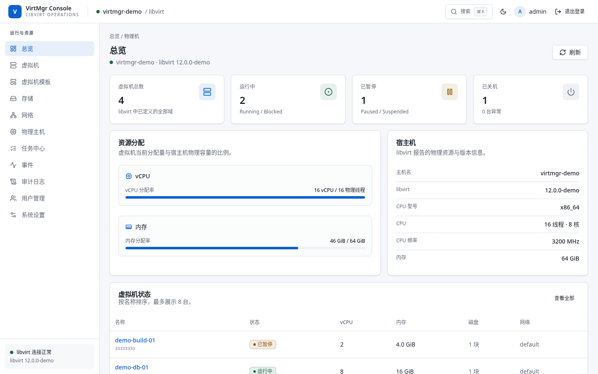
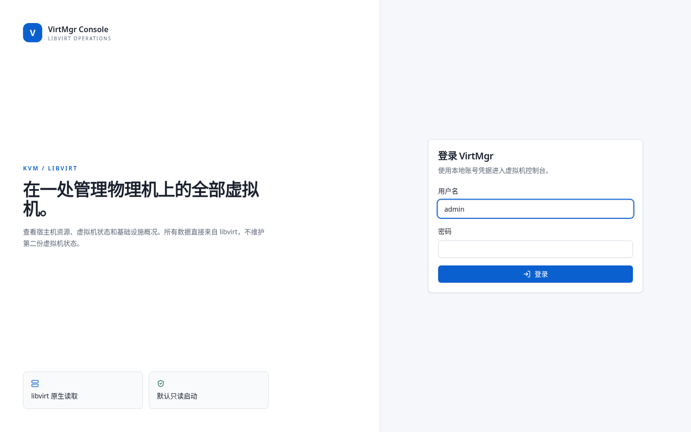
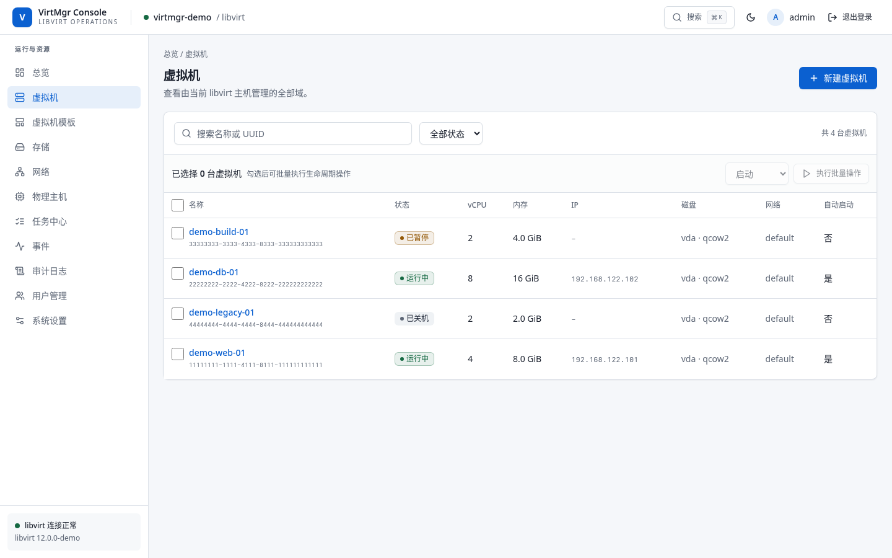
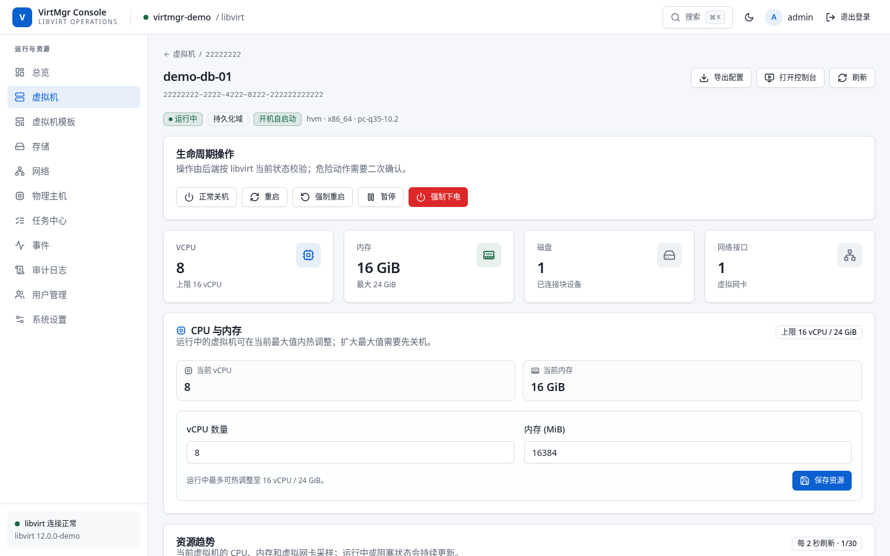
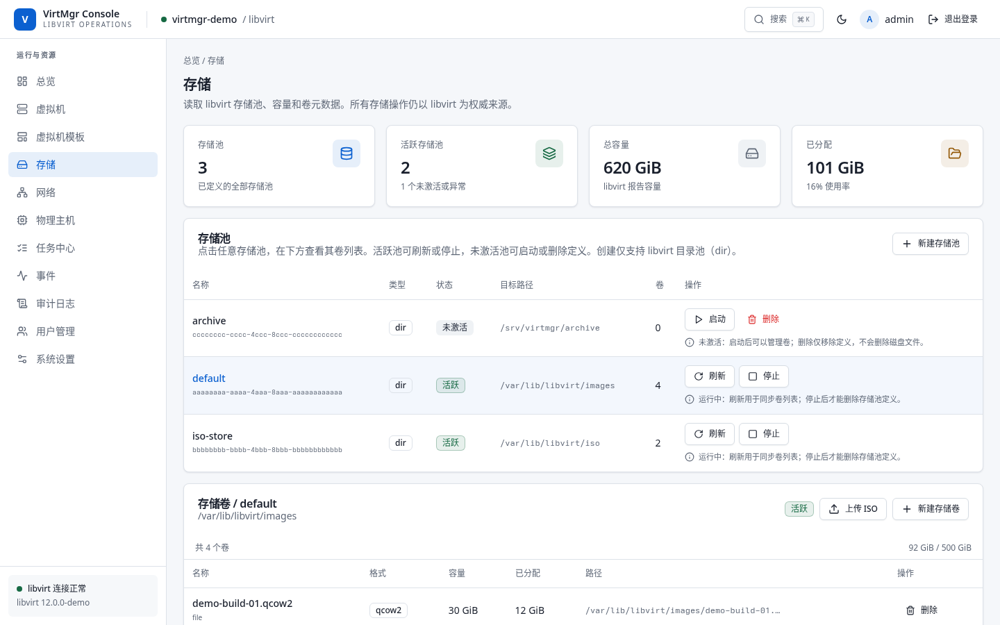
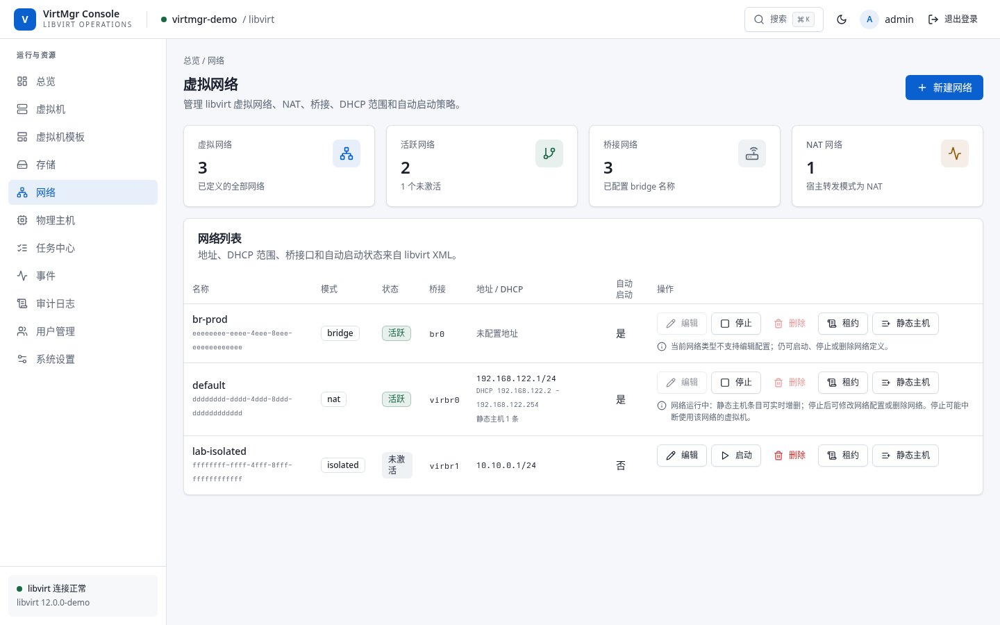

<div align="center">
  <h1>VirtMgr</h1>
  <p><strong>A lightweight web console for managing KVM/libvirt virtual machines.</strong></p>
  <p>VirtMgr exposes host health, virtual machine lifecycle operations, storage, networking, snapshots, graphical and serial consoles, audit logs, and long-running tasks from a single self-hosted web application.</p>
  <p>
    <a href="#screenshots">Screenshots</a> ·
    <a href="#feature-overview">Features</a> ·
    <a href="#quick-start">Quick start</a> ·
    <a href="#configuration">Configuration</a> ·
    <a href="#authentication-and-permissions">Permissions</a> ·
    <a href="#development-and-testing">Development</a> ·
    <a href="README.zh-CN.md">简体中文</a>
  </p>
  <p>
    <a href="LICENSE"></a>
    <a href="https://github.com/xuthus5/virtmgr/actions/workflows/release.yml"></a>
    <a href="https://github.com/xuthus5/virtmgr/releases/latest"></a>
    
    
  </p>
  
</div>

## What is VirtMgr?

VirtMgr is a self-hosted management console for a single KVM/libvirt host. It is designed for home labs, single-server private clouds, and teams that want a practical browser-based alternative to repeated `virsh` commands.

libvirt remains the source of truth for virtual machines, storage pools, networks, snapshots, and host resources. SQLite is used for local users, sessions, templates, snapshot policies, tasks, runtime settings, audit records, and compressed history of persistent domain XML definitions. VirtMgr does not maintain a second copy of live VM state.

The application ships as one Go binary with the React frontend embedded through `go:embed`. It connects directly to the libvirt socket, supports native TLS or TLS termination by a reverse proxy, and runs cleanly as a systemd service.

## Screenshots

All screenshots use the built-in demo backend, not production host data.

| Sign in | Overview |
|---|---|
|  |  |

| Virtual machines | VM details |
|---|---|
|  |  |

| Storage pools and volumes | Virtual networks |
|---|---|
|  |  |

## Feature overview

| Area | Capabilities |
|---|---|
| Overview | Host CPU, memory, libvirt version, VM counts, allocation ratios, warnings, and recent VM status |
| Virtual machines | Search and filter domains by state, tag, and owner; persist filters locally and favorite frequently used VMs; view state, vCPU, memory, disk, network, IP, and autostart; perform single or batch lifecycle actions |
| VM creation | BIOS/UEFI, Secure Boot, existing or manual disk, full or same-pool qcow2 linked clone from a registered image, disk bus (virtio/SATA/SCSI), NIC model (virtio/e1000), boot order, network selection, ISO, autostart, and a Cloud-init seed ISO with user-data, network-config, and vendor-data |
| VM import | Import a RAW/QCOW2 system disk or ISO installation media from an active storage pool, or upload one first; copy disk images to an independent volume, or create a blank QCOW2 system disk and mount the ISO as a read-only boot CD-ROM |
| VM details | Tags/notes/owner metadata, hardware summary, live and historical CPU/memory/network/disk throughput and IOPS trends, per-NIC throughput, disks, NICs, structured Guest Agent information, Cloud-init execution status and log-tail diagnostics, controlled file/password/SSH/process actions, policy health history, snapshots, and domain XML |
| Console | Embedded and standalone noVNC / xterm.js consoles, VNC-to-serial switching, Cockpit-style key combinations, scaling, disconnect/reconnect, fullscreen, and a detachable window; all sessions use one-time tokens and a server-side WebSocket proxy |
| VM operations | Start, graceful shutdown, reboot, reset, pause, resume, force off, delete, clone, import, cold backup, autostart, CPU/memory adjustment, disk expansion, and data-disk/NIC hotplug |
| Domain XML | Read live or persistent XML in CodeMirror; admins can validate and edit the persistent configuration in writable mode |
| Configuration history | Automatically archives persistent domain XML after config changes and external libvirt updates; compare, pin, download, and roll back to an earlier definition |
| Snapshots | Create, revert, delete, and schedule per-VM snapshots with interval or daily-time retention policies |
| Backups | Central cold-backup catalog, portable ZIP export/import, manual integrity checks, restore as a new VM, interval/daily schedules, retention, pinning, failed-task retry, and task SSE state |
| Image library | Register existing qcow2/raw volumes with OS metadata; refresh allocation and SHA-256 on demand; bind images to templates and create VMs by full clone or same-pool qcow2 linked clone without deleting the source volume when unregistering |
| Storage | Manage directory pools; start, stop, refresh, and delete definitions; create qcow2/raw volumes; stream ISO, qcow2, and raw image uploads; protect in-use volumes |
| Networking | NAT, isolated, and external bridge networks; IPv4-only, dual-stack, and IPv6-only managed networks; DHCP, SLAAC, stateful DHCPv6, NAT66, network MTU, DNS forwarding and static A/AAAA records; host bridge discovery, live leases, static IPv4/IPv6 reservations with CSV import/export, IPv4/IPv6 inbound port forwarding for NAT networks, diagnostics, create/edit/start/stop/delete |
| Host devices | PCI, USB, network, block, and DRM device inventory with PCI/USB passthrough attach and detach |
| Observability | SSE events and task state, backup retry, seven-day host/running-VM history, Prometheus `/metrics`, CPU/memory threshold Webhook alerts, structured logs, and health endpoints |
| Security | Local accounts, Argon2id passwords, self-service password change, admin password reset and session revocation, scoped and revocable Bearer API tokens, OpenAPI 3.1, HttpOnly/SameSite cookies, CSRF protection, role-based access, global read-only mode, filterable/exportable/retention-managed audit trail, CSP and security headers |
| System management | Version/commit/build time, online SQLite export, audit retention, and global read-only settings |
| User experience | Responsive layout, fixed and collapsible navigation, light/dark themes, keyboard-friendly global search, locally persisted list filters and favorites, accessible dialogs, and explicit confirmation for destructive actions |
| Templates | Reusable VM specifications, optional image binding, firmware/network defaults, and interactive Cloud-init defaults (packages, commands, locale, sudo/SSH user) without instance names or disk paths |

## Architecture

```text
Browser
  │ HTTPS
  ▼
React + TypeScript + Vite
  │ REST / SSE / WebSocket
  ▼
Go HTTP server and domain modules
  ├── libvirt Go binding ──► libvirtd / QEMU-KVM
  ├── modernc.org/sqlite ──► users, sessions, tasks, audit, templates, policies
  └── libvirt event loop ──► SSE event stream
```

The frontend is compiled into the Go binary, so production deployment does not require a separate web server. The backend follows an `http → app → domain` dependency direction, with infrastructure adapters under `internal/platform`.

See [docs/architecture-design.md](docs/architecture-design.md) for the detailed design, data model, route map, and operational boundaries. The design document is currently written in Chinese.

## Quick start

### Prerequisites

- Linux host with KVM/QEMU and libvirt
- Go `1.27.4+` (includes the standard-library `net/http` security fixes)
- Node.js `24+` and npm
- A C compiler, `pkg-config`, and libvirt development headers because the libvirt Go binding uses CGO
- A Unix socket reachable through `qemu:///system`, normally `/var/run/libvirt/libvirt-sock`

On Fedora-based hosts, a typical development setup is:

```bash
sudo dnf install -y gcc make pkg-config libvirt libvirt-devel qemu-kvm
sudo systemctl enable --now libvirtd
```

Package names differ across distributions. Ensure that `libvirt-dev` or `libvirt-devel`, QEMU/KVM, and the libvirt daemon are installed before building.

### Build from source

```bash
git clone git@github.com:xuthus5/virtmgr.git
cd virtmgr

npm --prefix web ci
make build

./bin/virtmgr version
```

`make build` builds the React frontend first, embeds it into the binary, and produces `bin/virtmgr`.

### Run the demo backend

The demo mode uses a libvirt fixture backend and does not require a running libvirt service. It is intended for UI review and development only.

```bash
cat >/tmp/virtmgr-demo.yaml <<'EOF'
listen: 127.0.0.1:8443
libvirt_uri: qemu:///system
database_path: /tmp/virtmgr-demo.db
admin_username: admin
admin_password: change-this-password
read_only: false
demo_mode: true
EOF

./bin/virtmgr --config /tmp/virtmgr-demo.yaml
```

Open <http://127.0.0.1:8443> and sign in with `admin` and the password configured above.

### Frontend development

Run the Go API and Vite development server in separate terminals:

```bash
cp deploy/server.yaml.example server.yaml
# Edit server.yaml, at minimum admin_password and database_path.
go run ./cmd/virtmgr --config ./server.yaml
```

```bash
cd web
npm run dev
```

Vite serves the UI on <http://127.0.0.1:5173> and proxies `/api`, `/healthz`, and `/readyz` to the Go server on port `8443`.

## Deploy as a systemd service

### 1. Install the binary and service account

```bash
sudo useradd --system --home /var/lib/virtmgr --shell /sbin/nologin --groups libvirt virtmgr
sudo install -d -o virtmgr -g virtmgr -m 0750 /var/lib/virtmgr
sudo install -d -o root -g virtmgr -m 0750 /etc/virtmgr

sudo install -m 0755 bin/virtmgr /usr/local/bin/virtmgr
sudo install -m 0640 -o root -g virtmgr deploy/server.yaml.example /etc/virtmgr/server.yaml
sudo install -m 0644 deploy/virtmgr.service /etc/systemd/system/virtmgr.service
```

If the service account already exists, adjust the `useradd` command rather than recreating it.

### 2. Configure server.yaml

Edit `/etc/virtmgr/server.yaml`:

```yaml
listen: 127.0.0.1:8443
libvirt_uri: qemu:///system
database_path: /var/lib/virtmgr/virtmgr.db
host_name: virt-host-01
admin_username: admin
admin_password: replace-with-a-strong-password
session_ttl: 8h
cookie_secure: false
trusted_proxies:
  - 127.0.0.1/32
read_only: false
demo_mode: false
```

`admin_password` is only used when the database has no users. After the first successful start, remove the plaintext password. The configuration file contains the initial administrator password, so keep it readable only by root and the `virtmgr` group. VirtMgr reads `/etc/virtmgr/server.yaml` by default; use `--config` to select another path. Unknown YAML fields cause startup to fail.

### 3. Start and verify

```bash
sudo systemctl daemon-reload
sudo systemctl enable --now virtmgr
sudo systemctl status virtmgr --no-pager

curl -fsS http://127.0.0.1:8443/healthz
curl -fsS http://127.0.0.1:8443/readyz
```

Follow logs with:

```bash
sudo journalctl -u virtmgr -f
```

### HTTPS and reverse proxies

VirtMgr supports HTTPS in two ways:

**Native TLS**

```yaml
listen: 0.0.0.0:8443
tls_cert_file: /etc/virtmgr/tls/fullchain.pem
tls_key_file: /etc/virtmgr/tls/privkey.pem
cookie_secure: true
```

Both TLS files must be configured together. Restrict the private key to the service account.

**TLS termination by nginx, Caddy, or a tunnel**

Keep VirtMgr bound to `127.0.0.1:8443`, proxy all application paths, preserve WebSocket upgrades for the VNC console, and set `cookie_secure: true` whenever the browser accesses the service over HTTPS. Set `trusted_proxies` to the reverse proxy addresses or CIDRs (for example `127.0.0.1/32` or `10.0.0.0/8`) before relying on `X-Forwarded-For` or `X-Real-IP`; untrusted clients cannot override the recorded source address. HTTPS deployments also receive `Strict-Transport-Security: max-age=31536000`.

The console uses a same-origin `wss://` connection. Some browsers let users bypass a self-signed certificate for the HTTPS page while still blocking the WebSocket handshake, which leaves the console connecting although the server never receives an Upgrade request. Use a certificate and hostname trusted by the browser in production; do not rely on an IP address with a self-signed certificate as the long-term console entry point.

**IPv6 management access**

Set `listen: "[::]:8443"` to bind the management service on the Linux dual-stack wildcard. Add the reverse proxy's IPv6 addresses to `trusted_proxies` when using `X-Forwarded-For` or `X-Real-IP`. To restrict management-plane sources, set IPv4/IPv6 CIDRs in `management_allowed_networks`; the check runs after trusted proxy address resolution. Browser access through a literal IPv6 address requires that address in the certificate SAN; because provider-assigned IPv6 prefixes can change, prefer a stable DNS name and certificate for production. Always retain the current management IPv6 prefix in the allowlist before enabling it to avoid locking administrators out. Native TLS certificates reload automatically after the certificate or key file changes, and the system settings page reports SAN mismatches and expiry. Guest-network IPv6 forwarding and NAT66 depend on the host's `net.ipv6.conf.all.forwarding` setting and firewall policy; NAT66 is outbound-only. Use the network diagnostics page before exposing workloads. Run `scripts/ipv6-compat-check.sh` on each supported host distribution. See `docs/ipv6-commercial-readiness.md` for the verified matrix and remaining boundaries, and `docs/tls-rotation-runbook.md` for certificate rotation and rollback.

Do not expose a writable VirtMgr instance directly to the public internet without TLS, a firewall, and a strong administrator password.

## Container deployment

The repository includes a multi-stage image and a Compose example. The container runs as an unprivileged user and mounts the host libvirt socket plus a persistent data volume.

```bash
cd deploy/docker
cp ../../deploy/server.yaml.example server.yaml
# Edit server.yaml for admin_password, host_name, and optional TLS paths.
# Adjust the LIBVIRT_GID default in compose.yaml when needed.

# Docker Compose
docker compose up -d --build

# or Podman Compose
podman compose up -d --build
```

Set `LIBVIRT_GID` to the group ID that owns `/var/run/libvirt/libvirt-sock` on the host (`stat -c '%g' /var/run/libvirt/libvirt-sock`). For native TLS, uncomment the certificate mount in Compose and set `tls_cert_file` / `tls_key_file` in `server.yaml`. If backup or storage features need direct access to host storage paths, mount those directories at the same paths; do not use `--privileged`.

## Configuration

| `server.yaml` field | Default | Description |
|---|---|---|
| `listen` | `127.0.0.1:8443` | HTTP/HTTPS listen address |
| `tls_cert_file` | empty | PEM certificate chain for native TLS; must be set with the key |
| `tls_key_file` | empty | PEM private key for native TLS; must be set with the certificate |
| `libvirt_uri` | `qemu:///system` | libvirt connection URI |
| `database_path` | `/var/lib/virtmgr/virtmgr.db` | SQLite database path |
| `host_name` | OS hostname | Display name for the managed host |
| `admin_username` | `admin` | Initial administrator username when the user table is empty |
| `admin_password` | empty | Initial administrator password; required only for the first start |
| `session_ttl` | `8h` | Login session lifetime; must be a positive Go duration |
| `cookie_secure` | `false` | Mark the session cookie as `Secure`; enable it for HTTPS deployments |
| `trusted_proxies` | empty list | Proxy IPs/CIDRs allowed to supply `X-Forwarded-For` and `X-Real-IP` |
| `management_allowed_networks` | empty list | Management-plane source IP/CIDR allowlist, including IPv6; an empty list allows all sources |
| `read_only` | `false` | Initial global write-protection state; the persisted SQLite value takes precedence after first start |
| `demo_mode` | `false` | Use the demo backend for UI development; never enable this in production |

Changes to the database, libvirt connection, or TLS paths require a service restart. The read-only mode can also be changed at runtime from the admin settings page and is persisted in SQLite.

## Authentication and permissions

VirtMgr uses local accounts. Passwords are hashed with Argon2id, sessions are stored as hashes in SQLite, and the browser receives only an `HttpOnly` and `SameSite=Strict` session cookie. Every state-changing API request requires the session's CSRF token in `X-CSRF-Token`. Failed logins are rate-limited per username and source address and return `429 TOO_MANY_ATTEMPTS`; unknown and disabled accounts use the same password-hashing cost to reduce account-enumeration signals.

Users can also create scoped Bearer API tokens from Settings. A `read` token is limited to safe methods, while `write` also includes read; tokens support an expiration and immediate revocation, store only a hash in SQLite, and reveal the plaintext once at creation. Bearer requests do not use browser CSRF but remain subject to token scope, role, read-only mode, and audit checks. Token-authenticated clients cannot create, list, or revoke tokens.

| Role | Read access | VM lifecycle and create/clone/backup | Snapshots, storage, networks, templates | VNC console | Edit domain XML | Users, settings, audit |
|---|---:|---:|---:|---:|---:|---:|
| `viewer` | Yes | No | No | No | No | No |
| `operator` | Yes | Yes | Yes | Yes | No | No |
| `admin` | Yes | Yes | Yes | Yes | Yes | Yes |

The global read-only mode blocks all mutating infrastructure operations regardless of role. Read-only inventory, domain XML viewing, configuration export, and metric/event queries remain available.

Administrators can create users, change roles, disable accounts, reset other users' passwords, inspect and revoke login sessions, filter and export the audit log by time or target, and change the persisted read-only setting from the web UI. Every local account can also open **Account security** from the top bar, verify its current password, and change it; the current session is kept while other sessions are revoked.

The login page includes a **Forgot password?** entry. Single-host VirtMgr does not depend on email, so password recovery is performed locally by an account that can access the database file:

```bash
sudo -u virtmgr /usr/local/bin/virtmgr reset-password --username admin --config /etc/virtmgr/server.yaml
```

The command prompts for the new password with hidden input, revokes every session for that account, and records an audit event without password contents. Docker deployments should run the equivalent command inside the container.

## Safety and operational behavior

- **Libvirt is authoritative.** VirtMgr does not store a second VM inventory and degrades explicitly when libvirt is unavailable.
- **Destructive operations require confirmation.** Force off, reset, snapshot revert, volume deletion, and VM deletion use explicit dialogs; some delete flows require typing the resource name.
- **Long-running work becomes a task.** Storage volume uploads, format conversion/cross-pool copies, cloning, and cold backups expose progress, steps, failures, and related resources through the task center. Supported tasks can be cancelled at safe checkpoints; cancellation is cooperative and may leave intermediate files until cleanup.
- **Image removal does not delete a disk.** The image library registers existing qcow2/raw volumes, computes SHA-256 on refresh, and always keeps the underlying volume when an entry is removed; removal is rejected while a template references it. VM creation defaults to a full clone, with same-pool qcow2 linked clones available as an option, and linked-clone bases cannot be deleted while referenced. The storage page can convert an idle qcow2/raw volume and copy it to another active pool; the source is retained and VM references are not rewritten. Cross-pool linked clones and automatic movement with reference switching are not implemented.
- **Backups restore as new VMs.** A backup contains the persistent domain XML, a SHA-256 manifest, and writable file disks, but not RAM state. In-place restore and RAM-state restore are not provided.
- **Disk expansion has host and guest layers.** VirtMgr first grows the qcow2/raw virtual disk. When the Guest Agent is connected and advertises the capability, it can also grow a non-root ext4/xfs filesystem backed by a direct block device on Linux using fixed `growpart` and `resize2fs`/`xfs_growfs` commands. Root filesystems, LVM, Windows guests, and guests without an agent still require manual expansion inside the guest. Shrinking is not supported.
- **CPU and memory changes respect libvirt limits.** Running domains can be adjusted within their active maximum; increasing the maximum generally requires shutting the VM down first.
- **Consoles are proxied server-side.** VNC and serial sessions use short-lived, single-use tokens; the host VNC port is never exposed directly. The console view supports keyboard shortcuts, reconnect, fullscreen, and a detachable window.
- **Cloud-init content is not written to audit logs.** Auditing records only whether Cloud-init was enabled, the storage pool, and byte counts.
- **XML edits are restricted.** Only administrators in writable mode can update the persistent definition; name and UUID are immutable, QEMU command-line namespaces are rejected, and libvirt performs validation before the definition is saved.
- **Configuration rollback only restores XML.** Version history keeps compressed persistent definitions, not disks, snapshots, or live memory. Rollback is admin-only, checks the current SHA-256 to avoid overwriting concurrent changes, archives the current definition first, and requires a VM restart for running domains.
- **Guest Agent is optional and capability-gated.** New VMs get the QGA channel by default; existing persistent domains can add it only while stopped. VM details expose a **Change guest password** toolbar action that opens a focused dialog; when the agent is unavailable, the dialog explains the connection or installation reason instead of leaving a permanent password card on the page. Full Guest Agent status and controls live in the **Guest Agent** tab, while the overview only shows a compact connected badge. Agent shutdown, reboot, time sync, TRIM, quiesced snapshots, bounded file read/write, password reset, SSH authorized-key management, login-user listing, SIGTERM/SIGKILL process management, non-root online filesystem growth, and read-only package/update inventory are enabled only when the guest advertises the corresponding capability. Linux guests can also inspect Cloud-init state, failed systemd services, kernel/system errors, OOM events, and bounded log tails through fixed-path `systemctl`/`journalctl` queries. Package inventory is read-only and uses fixed `dpkg-query`/`apt-get -s`, `rpm`, `dnf`/`yum`, or `zypper` queries; it never installs, upgrades, removes, or refreshes packages. VirtMgr still does **not** expose a generic arbitrary-command endpoint: process operations use fixed `/bin/ps` or `/usr/bin/ps` and `/bin/kill` or `/usr/bin/kill` commands with fixed arguments. File operations require absolute paths, are limited to 1 MiB per request, and use 64 KiB chunks. Passwords and full SSH keys are never written to audit details; only fingerprints and counts are retained.

## API

The API is exposed under `/api/v1` and uses JSON. Browser sessions use cookies and `X-CSRF-Token` for mutating requests; automation can use a Bearer API token with a `read` or `write` scope. The OpenAPI 3.1 contract is available at `GET /api/v1/openapi.json`.

Representative endpoint groups include:

| Area | Examples |
|---|---|
| Session | `POST /api/v1/session`, `GET /api/v1/session`, `DELETE /api/v1/session` |
| Automation | `GET/POST /api/v1/api-tokens`, `DELETE /api/v1/api-tokens/{id}`, `GET /api/v1/openapi.json` |
| Overview and host | `/api/v1/overview`, `/api/v1/host`, `/api/v1/host/devices`, `/api/v1/host/metrics` |
| Virtual machines | `/api/v1/vms`, `/api/v1/vms/import`, `/api/v1/vms/{uuid}`, `/metrics`, `/xml`, `/config-versions`, `/snapshots`, `/guest-agent`, `/guest-agent/files`, `/guest-agent/password`, `/guest-agent/ssh-keys`, `/guest-agent/processes`, `/guest-agent/users`, `/guest-agent/policy`, `/guest-agent/health`, `/devices`, `/actions/{action}` |
| VM operations | `/resources`, `/disks/{target}`, `/clone`, `/backups`, `/console-token`, `/console/send-key`, `/console`, `/serial-console`, `/export` |
| Backup center | `/api/v1/backups`, `/backups/{id}/verify`, `/backups/{id}/restore`, `/backup-schedules`, `/backup-repositories` |
| Storage | `/api/v1/storage/pools`, `/volumes`, `/volumes/upload` |
| Images | `GET/POST /api/v1/images`, `GET/DELETE /api/v1/images/{id}`, `POST /api/v1/images/{id}/refresh` |
| Networking | `/api/v1/networks`, `/networks/bridges`, `/leases`, `/hosts`, `/diagnostics`, `/actions/{action}` |
| System | `/api/v1/events`, `/events/stream`, `/tasks`, `/templates`, `/audit-events`, `/audit-events/export`, `/users`, `/users/me/password`, `/users/{id}/sessions`, `/settings` |

Task cancellation is available at `POST /api/v1/tasks/{id}/cancel` for supported task kinds and safe checkpoints.

The complete route and behavior reference is maintained in [docs/architecture-design.md](docs/architecture-design.md).

## Development and testing

```bash
# Backend and frontend unit tests
make test

# Go vet
make vet

# Build the binary and embedded frontend
make build

# Serial Playwright E2E suites (read-only and writable demo modes)
make e2e
```

The Playwright configuration is intentionally serial: `workers: 1`, `fullyParallel: false`, and `maxFailures: 1`. Do not override these constraints with higher concurrency. The test suites use separate ports and temporary SQLite databases.

Real libvirt integration tests are opt-in and require a host with `qemu:///system`:

```bash
VIRTMGR_TEST_REAL_LIBVIRT=1 go test ./internal/platform/libvirt -run TestRealLibvirtReadOnly -v
VIRTMGR_TEST_REAL_LIBVIRT=1 go test ./internal/platform/libvirt -run TestRealLibvirtCloudInitCreate -v
```

### Release binaries

Publishing a GitHub Release runs [`.github/workflows/release.yml`](.github/workflows/release.yml). The workflow builds Linux binaries for `amd64` and `arm64`, packages each binary as a tarball, generates `checksums.txt`, and attaches the artifacts to the release.

## Project structure

```text
cmd/virtmgr/              Application entrypoint
internal/bootstrap/       Dependency wiring, HTTP router, lifecycle, security headers
internal/domain/          Domain types, validation, and error contracts
internal/modules/         Feature modules with http/app layers
internal/platform/        libvirt, SQLite, auth context, metrics, tasks, config
web/                      React + TypeScript + Vite + Tailwind UI
deploy/                   systemd, container image, Compose, and environment examples
docs/                     Architecture documentation and screenshots
scripts/                  Development and E2E helpers
.github/workflows/        Release binary pipeline
```

## Compatibility and limitations

- One VirtMgr instance manages one libvirt endpoint. Cross-host scheduling, migration, and multi-cluster inventory are not implemented.
- Linux with KVM/QEMU and the libvirt Go binding is the supported runtime. Building requires CGO and libvirt development headers.
- Graphical consoles currently support VNC only; SPICE is not supported. Serial consoles support libvirt PTY devices, with one active browser session per serial device.
- Container deployment requires the host libvirt socket and a supplementary group matching the socket GID. Mount any directly accessed storage paths at the same paths inside the container.
- Backups are cold, full copies for persistent VMs and `file`-backed disks. Completed backups can be downloaded as self-contained ZIP packages and imported into the backup catalog; imports use new backup IDs and artifact names. Incremental backup, in-place restore, cross-host replication, and automatic content verification are not implemented.
- VM import supports active-pool QCOW2/RAW system disks and ISO installation media. ISO imports create a blank system disk and retain the source ISO as a read-only CD-ROM. OVA/OVF, VMDK, and VHDX are not accepted directly; existing idle qcow2/raw volumes can be converted or copied to another pool from the storage page.
- The image library supports qcow2/raw uploads, full clones, and same-pool qcow2 linked clones. The storage page supports idle-volume qcow2/raw conversion and cross-pool copies, but cross-pool linked clones, automatic linked-clone flattening, and automatic VM reference switching are not implemented.
- Automatic backup content verification and DST-specific scheduling are out of scope; daily schedules use the server's local time zone.
- Managed NAT/isolated networks support IPv4-only, dual-stack, and IPv6-only addressing. IPv4 uses DHCP; IPv6 supports SLAAC (`/64`) and stateful DHCPv6 (`/64` to `/124`), with NAT66 enabled by default for NAT dual-stack networks. DNS forwarding, DHCPv6 DUID/Client-ID reservations, network diagnostics, and CSV import/export are available. NAT networks support TCP/UDP inbound port forwarding for IPv4 and IPv6 through the controlled `virtmgr_pf` nftables table; this requires `CAP_NET_ADMIN`. External bridge networks attach to an existing host Linux bridge and use upstream addressing/DHCP. Per-interface inbound/outbound bandwidth QoS is available. VirtMgr does not create host bridges and does not manage VLAN, bond, OVS, SR-IOV, explicit RA flags/prefix delegation, or security groups.
- Alerts use the existing rule-level Webhook only. Notification centers, SMTP, Slack/Teams, PagerDuty, alert silencing, and escalation policies are not provided.
- VM disk shrinking, arbitrary host shell access, and unrestricted libvirt API proxying are intentionally out of scope.
- Modern Chrome, Edge, Firefox, and Safari are recommended.

## Documentation

- [Architecture design](docs/architecture-design.md) — product boundaries, architecture, data model, routes, security, and deployment details (Chinese)
- [Product gap analysis](docs/product-gap-analysis.md) — comparison with mainstream tools, single-host roadmap, and implemented capability status (Chinese)
- [Backup and restore design](docs/backup-design.md) — implemented cold-backup catalog, restore, scheduling, and retention model (Chinese)
- [Container image](deploy/docker/Dockerfile) and [Compose example](deploy/docker/compose.yaml) — libvirt socket and unprivileged runtime
- [Release workflow](.github/workflows/release.yml) — amd64/arm64 binary build and release attachment
- [server.yaml example](deploy/server.yaml.example) — production-oriented configuration template
- [systemd unit](deploy/virtmgr.service) — hardened service definition

## License

Licensed under the [Apache License, Version 2.0](LICENSE).

You may use, modify, and distribute this project in accordance with the terms of that license. Unless required by applicable law or agreed to in writing, software distributed under the license is provided on an "AS IS" BASIS, WITHOUT WARRANTIES OR CONDITIONS OF ANY KIND, either express or implied.
