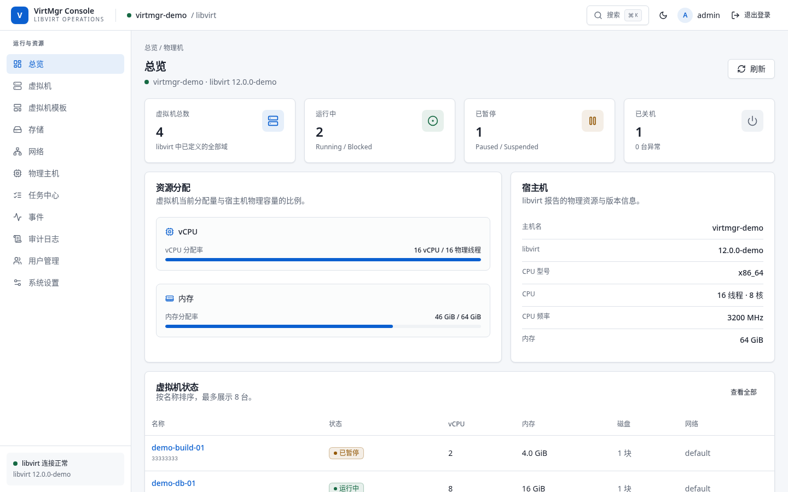
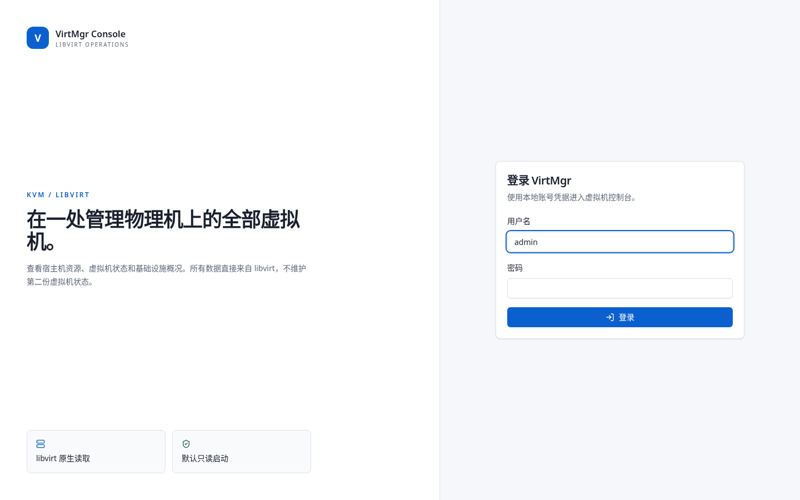
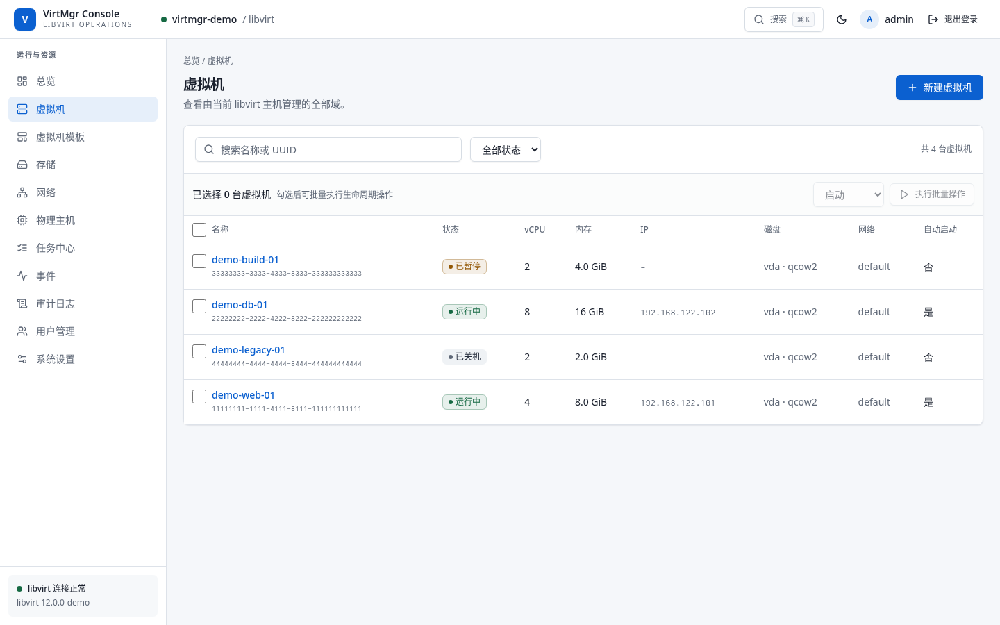
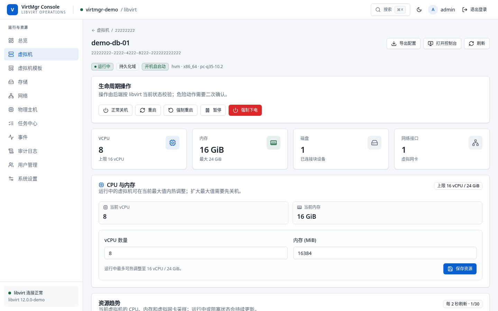
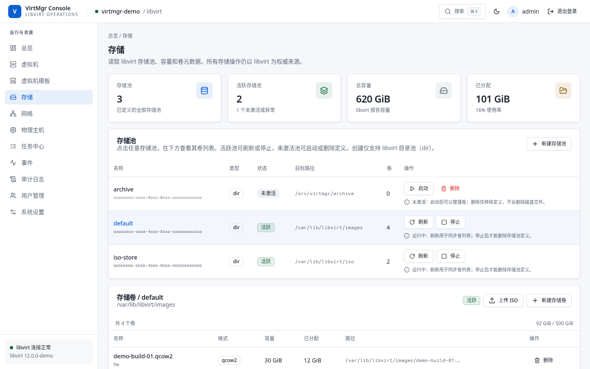
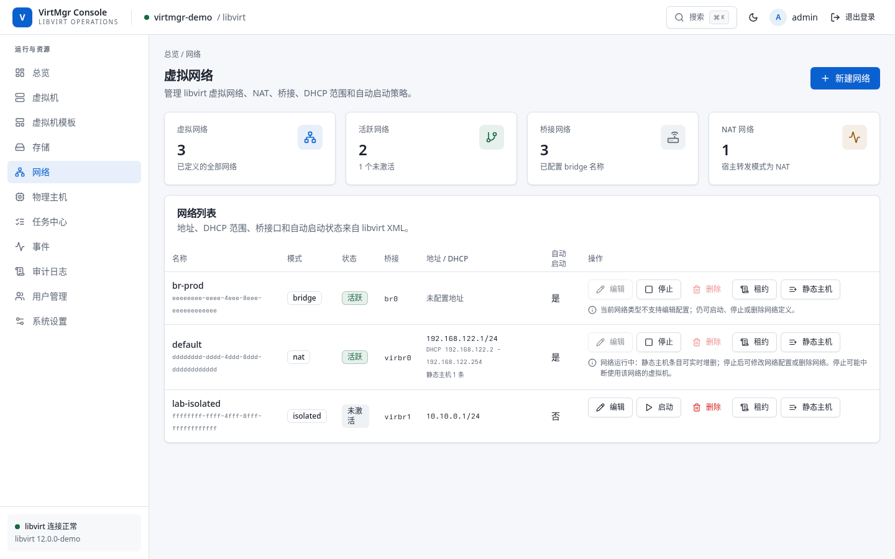

<div align="center">
  <h1>VirtMgr</h1>
  <p><strong>面向 KVM/libvirt 虚拟机的轻量级 Web 管理控制台。</strong></p>
  <p>VirtMgr 在单个自托管 Web 应用中提供宿主机健康度、虚拟机生命周期、存储、网络、快照、图形与串口控制台、审计日志和长任务管理能力。</p>
  <p>
    <a href="#项目截图">项目截图</a> ·
    <a href="#功能一览">功能一览</a> ·
    <a href="#快速开始">快速开始</a> ·
    <a href="#配置项">配置项</a> ·
    <a href="#认证与权限">认证与权限</a> ·
    <a href="#开发与测试">开发与测试</a> ·
    <a href="README.md">English</a>
  </p>
  <p>
    <a href="LICENSE"></a>
    <a href="https://github.com/xuthus5/virtmgr/actions/workflows/release.yml"></a>
    <a href="https://github.com/xuthus5/virtmgr/releases/latest"></a>
    
    
  </p>
  
</div>

## VirtMgr 是什么

VirtMgr 是面向单台 KVM/libvirt 宿主机的自托管管理控制台。它适用于家庭实验室、单机私有云，以及希望用浏览器替代重复 `virsh` 操作的运维场景。

虚拟机、存储池、网络、快照和宿主机资源的唯一事实来源始终是 libvirt。SQLite 保存本地用户、会话、虚拟机模板、定时快照策略、任务、运行时设置、审计记录，以及压缩后的持久域 XML 版本历史，不额外维护一份虚拟机运行状态。

前端通过 `go:embed` 打包进 Go 二进制，生产部署不需要单独运行 Web 服务器。VirtMgr 可直接连接本机 libvirt Socket，支持原生 HTTPS 或由反向代理终止 TLS，并以 systemd 服务运行。

## 项目截图

以下截图均来自内置 demo 后端，不包含真实宿主机信息。

| 登录页 | 总览 |
|---|---|
|  |  |

| 虚拟机列表 | 虚拟机详情 |
|---|---|
|  |  |

| 存储池与存储卷 | 虚拟网络 |
|---|---|
|  |  |

## 功能一览

| 模块 | 主要能力 |
|---|---|
| 总览 | 宿主机 CPU、内存、libvirt 版本、虚拟机数量、资源分配率、异常提醒和近期虚拟机状态 |
| 虚拟机 | 搜索和筛选域；查看状态、vCPU、内存、磁盘、网络、IP 和自动启动；支持单台与批量生命周期操作 |
| 创建虚拟机 | BIOS/UEFI、Secure Boot、已有磁盘或手工路径、网络选择、ISO、自动启动和可选 Cloud-init seed ISO |
| 虚拟机详情 | 硬件摘要、CPU/内存/网络实时趋势、磁盘、网卡、Guest Agent 信息、快照和域 XML |
| Web 控制台 | 页面内嵌或独立窗口打开 noVNC / xterm.js 控制台，支持图形与串口切换、Cockpit 风格组合键、缩放、断开重连、全屏和分离窗口；会话均通过一次性 token 与服务端 WebSocket 代理 |
| 虚拟机操作 | 启动、正常关机、重启、强制重启、暂停、恢复、强制下电、删除、克隆、冷备份、自动启动、CPU/内存调整和磁盘扩容 |
| 域 XML | 使用 CodeMirror 查看 live 或持久配置；管理员可在可写模式中校验并编辑持久配置 |
| 配置版本历史 | 配置变更和外部 libvirt 修改后自动归档持久域 XML；支持对比、固定、下载和回滚到早期定义 |
| 快照 | 创建、回滚、删除快照，并按保留策略配置定时快照 |
| 备份中心 | 集中管理冷备份、完整性校验、恢复为新虚拟机、定时计划、保留清理、固定保留和 libvirt 存储库 |
| 存储 | 管理目录型存储池；启动、停止、刷新和删除定义；创建 qcow2/raw 卷；上传 ISO；阻止删除仍在使用的卷 |
| 网络 | NAT 和隔离网络、桥接口、IPv4/DHCP 配置、实时租约、静态 DHCP 主机，以及创建、编辑、启停和删除 |
| 主机设备 | 展示 PCI、USB、网络、块和 DRM 设备，并支持 PCI/USB 设备直通与移除 |
| 可观测性 | SSE 实时事件、带进度和失败原因的任务中心、宿主机与虚拟机资源趋势、结构化日志和健康检查 |
| 安全 | 本地账号、Argon2id 密码、HttpOnly/SameSite Cookie、CSRF 防护、角色权限、全局只读模式、审计、CSP 和安全响应头 |
| 使用体验 | 响应式布局、固定且可折叠的侧边导航、明暗主题、键盘友好的全局搜索、可访问对话框和危险操作二次确认 |
| 虚拟机模板 | 复用虚拟机规格、固件/网络默认值和 Cloud-init 默认内容，不包含实例名称和磁盘路径 |

## 架构

```text
浏览器
  │ HTTPS
  ▼
React + TypeScript + Vite
  │ REST / SSE / WebSocket
  ▼
Go HTTP 服务与领域模块
  ├── libvirt Go binding ──► libvirtd / QEMU-KVM
  ├── modernc.org/sqlite ──► 用户、会话、任务、审计、模板和策略
  └── libvirt 事件循环 ────► SSE 事件流
```

前端编译后嵌入 Go 二进制，生产环境无需单独部署静态资源。后端遵循 `http → app → domain` 的依赖方向，libvirt、SQLite、指标和任务等基础设施适配放在 `internal/platform` 下。

更完整的产品边界、数据模型、路由和安全设计见 [docs/architecture-design.md](docs/architecture-design.md)。

## 快速开始

### 前置条件

- 已启用 KVM/QEMU 和 libvirt 的 Linux 宿主机
- Go `1.26+`
- Node.js `24+` 和 npm
- C 编译器、`pkg-config` 和 libvirt 开发头文件，因为 libvirt Go binding 使用 CGO
- 可通过 `qemu:///system` 访问 libvirt Socket，通常为 `/var/run/libvirt/libvirt-sock`

Fedora 系发行版的典型开发环境安装命令：

```bash
sudo dnf install -y gcc make pkg-config libvirt libvirt-devel qemu-kvm
sudo systemctl enable --now libvirtd
```

不同发行版的软件包名称可能不同。构建前请确认已安装 `libvirt-dev` 或 `libvirt-devel`、QEMU/KVM 以及 libvirt 服务。

### 从源码构建

```bash
git clone git@github.com:xuthus5/virtmgr.git
cd virtmgr

npm --prefix web ci
make build

./bin/virtmgr version
```

`make build` 会先构建 React 前端，再将其嵌入 Go 二进制，最终生成 `bin/virtmgr`。

### 运行 demo 后端

demo 模式使用内置的 libvirt 模拟后端，不需要正在运行的 libvirt 服务，仅用于界面验收和开发调试。

```bash
VIRTMGR_DEMO_MODE=true \
VIRTMGR_DATABASE_PATH=/tmp/virtmgr-demo.db \
VIRTMGR_ADMIN_PASSWORD='change-this-password' \
VIRTMGR_READ_ONLY=false \
./bin/virtmgr
```

打开 <http://127.0.0.1:8443>，使用用户名 `admin` 和上面配置的密码登录。

### 前端开发

分别在两个终端启动 Go API 和 Vite 开发服务器：

```bash
VIRTMGR_ADMIN_PASSWORD='dev-password' VIRTMGR_READ_ONLY=false go run ./cmd/virtmgr
```

```bash
cd web
npm run dev
```

Vite 在 <http://127.0.0.1:5173> 提供前端页面，并将 `/api`、`/healthz` 和 `/readyz` 代理到 `8443` 端口的 Go 服务。

## 使用 systemd 部署

### 1. 安装二进制和服务账号

```bash
sudo useradd --system --home /var/lib/virtmgr --shell /sbin/nologin --groups libvirt virtmgr
sudo install -d -o virtmgr -g virtmgr -m 0750 /var/lib/virtmgr
sudo install -d -o root -g virtmgr -m 0750 /etc/virtmgr

sudo install -m 0755 bin/virtmgr /usr/local/bin/virtmgr
sudo install -m 0640 -o root -g virtmgr deploy/virtmgr.env.example /etc/virtmgr/virtmgr.env
sudo install -m 0644 deploy/virtmgr.service /etc/systemd/system/virtmgr.service
```

如果服务账号已经存在，请调整 `useradd` 命令，不要重复创建。

### 2. 配置环境变量

编辑 `/etc/virtmgr/virtmgr.env`：

```dotenv
VIRTMGR_LISTEN=127.0.0.1:8443
VIRTMGR_LIBVIRT_URI=qemu:///system
VIRTMGR_DATABASE_PATH=/var/lib/virtmgr/virtmgr.db
VIRTMGR_HOST_NAME=virt-host-01
VIRTMGR_ADMIN_USERNAME=admin
VIRTMGR_ADMIN_PASSWORD=replace-with-a-strong-password
VIRTMGR_SESSION_TTL=8h
VIRTMGR_COOKIE_SECURE=false
VIRTMGR_READ_ONLY=true
VIRTMGR_DEMO_MODE=false
```

`VIRTMGR_ADMIN_PASSWORD` 仅在数据库中没有任何用户时使用。首次成功启动后，应从环境文件中移除明文密码。环境文件应只允许 root 和 `virtmgr` 组读取。

### 3. 启动并验证

```bash
sudo systemctl daemon-reload
sudo systemctl enable --now virtmgr
sudo systemctl status virtmgr --no-pager

curl -fsS http://127.0.0.1:8443/healthz
curl -fsS http://127.0.0.1:8443/readyz
```

查看实时日志：

```bash
sudo journalctl -u virtmgr -f
```

### HTTPS 与反向代理

VirtMgr 支持两种 HTTPS 部署方式：

**原生 TLS**

```dotenv
VIRTMGR_LISTEN=0.0.0.0:8443
VIRTMGR_TLS_CERT_FILE=/etc/virtmgr/tls/fullchain.pem
VIRTMGR_TLS_KEY_FILE=/etc/virtmgr/tls/privkey.pem
VIRTMGR_COOKIE_SECURE=true
```

证书和私钥必须同时配置。私钥文件应仅允许服务账号读取。

**由 nginx、Caddy 或隧道终止 TLS**

让 VirtMgr 继续监听 `127.0.0.1:8443`，反向代理全部应用路径，并为 Web VNC 保留 WebSocket Upgrade；浏览器通过 HTTPS 访问时，应设置 `VIRTMGR_COOKIE_SECURE=true`。

不要在没有 TLS、防火墙和强管理员密码的情况下，将可写模式的 VirtMgr 直接暴露到公网。

## 配置项

| 环境变量 | 默认值 | 说明 |
|---|---|---|
| `VIRTMGR_LISTEN` | `127.0.0.1:8443` | HTTP/HTTPS 监听地址 |
| `VIRTMGR_TLS_CERT_FILE` | 空 | 原生 TLS 的 PEM 证书链，必须与私钥同时配置 |
| `VIRTMGR_TLS_KEY_FILE` | 空 | 原生 TLS 的 PEM 私钥，必须与证书同时配置 |
| `VIRTMGR_LIBVIRT_URI` | `qemu:///system` | libvirt 连接 URI |
| `VIRTMGR_DATABASE_PATH` | `/var/lib/virtmgr/virtmgr.db` | SQLite 数据库路径 |
| `VIRTMGR_HOST_NAME` | 操作系统主机名 | 页面展示的被管理宿主机名称 |
| `VIRTMGR_ADMIN_USERNAME` | `admin` | 用户表为空时创建的初始管理员用户名 |
| `VIRTMGR_ADMIN_PASSWORD` | 未设置 | 初始管理员密码，仅在首次启动时需要 |
| `VIRTMGR_SESSION_TTL` | `8h` | 登录会话有效期，必须为正的 Go Duration |
| `VIRTMGR_COOKIE_SECURE` | `false` | 将会话 Cookie 标记为 `Secure`；HTTPS 部署应开启 |
| `VIRTMGR_READ_ONLY` | `true` | 初始全局只读状态 |
| `VIRTMGR_DEMO_MODE` | `false` | 使用 demo 后端，仅用于界面开发，生产环境禁止开启 |

修改数据库、libvirt 连接或 TLS 路径后需要重启服务。全局只读模式也可以在管理员设置页中动态切换，并会持久化到 SQLite。

## 认证与权限

VirtMgr 使用本地账号。密码通过 Argon2id 哈希，会话在 SQLite 中仅保存 token 哈希，浏览器只持有 `HttpOnly`、`SameSite=Strict` 的会话 Cookie。所有写请求还必须在 `X-CSRF-Token` 请求头中携带当前会话的 CSRF token。

| 角色 | 读取 | 虚拟机生命周期与创建/克隆/备份 | 快照、存储、网络、模板 | 图形/串口控制台 | 编辑域 XML | 用户、设置、审计 |
|---|---:|---:|---:|---:|---:|---:|
| `viewer` | 是 | 否 | 否 | 否 | 否 | 否 |
| `operator` | 是 | 是 | 是 | 是 | 否 | 否 |
| `admin` | 是 | 是 | 是 | 是 | 是 | 是 |

无论角色如何，全局只读模式都会阻止所有基础设施写操作。只读资源查询、域 XML 查看、配置导出、指标和事件查询仍然可用。

管理员可以在 Web 页面中创建用户、修改角色、禁用账号、查看审计日志，并切换持久化的全局只读设置。

## 安全与操作语义

- **libvirt 是唯一事实来源。** VirtMgr 不保存第二份虚拟机清单；libvirt 不可用时页面会明确降级，而不是展示伪造状态。
- **危险操作必须确认。** 强制下电、强制重启、快照回滚、删除存储卷和删除虚拟机都有明确确认流程，部分删除操作要求输入资源名称。
- **长任务进入任务中心。** ISO 上传、克隆和冷备份都会展示进度、步骤、失败原因和关联资源。
- **备份以新虚拟机方式恢复。** 备份包含持久域 XML、SHA-256 manifest 和可写文件磁盘，不包含内存状态；不支持原地覆盖恢复或内存状态恢复。
- **磁盘扩容不等于扩展客户机分区。** VirtMgr 只扩展 qcow2/raw 虚拟磁盘。Linux 客户机通常还需执行 `growpart` 和 `resize2fs`/`xfs_growfs`；Windows 客户机需在磁盘管理中扩展卷。不支持缩容。
- **CPU 与内存调整受 libvirt 上限约束。** 运行中的虚拟机只能在其活动最大值内热调整；提高最大值通常需要先关机。
- **控制台由服务端代理。** VNC 与串口会话均使用短时、一次性 token，宿主机 VNC 端口不会直接暴露。控制台支持组合键、重连、全屏和独立窗口。
- **Cloud-init 内容不写入审计。** 审计仅记录是否启用、存储池和字节数，不保存用户数据正文。
- **XML 编辑受到严格限制。** 只有可写模式下的管理员才能更新持久配置；名称和 UUID 不可变，QEMU commandline 命名空间会被拒绝，保存前由 libvirt 完成语义校验。
- **配置回滚只恢复 XML。** 版本历史保存压缩后的持久定义，不包含磁盘、快照或运行内存。回滚仅限管理员，会校验当前 SHA-256 以避免覆盖并发修改，先自动归档当前配置；运行中的虚拟机需重启后生效。

## API

API 位于 `/api/v1`，使用 JSON。认证基于 Cookie，写操作还需要 `X-CSRF-Token`。

主要接口分组如下：

| 模块 | 示例 |
|---|---|
| 会话 | `POST /api/v1/session`、`GET /api/v1/session`、`DELETE /api/v1/session` |
| 总览与宿主机 | `/api/v1/overview`、`/api/v1/host`、`/api/v1/host/devices`、`/api/v1/host/metrics` |
| 虚拟机 | `/api/v1/vms`、`/api/v1/vms/{uuid}`、`/metrics`、`/xml`、`/config-versions`、`/snapshots`、`/devices`、`/actions/{action}` |
| 虚拟机操作 | `/resources`、`/disks/{target}`、`/clone`、`/backups`、`/console-token`、`/console/send-key`、`/console`、`/serial-console`、`/export` |
| 备份中心 | `/api/v1/backups`、`/backups/{id}/verify`、`/backups/{id}/restore`、`/backup-schedules`、`/backup-repositories` |
| 存储 | `/api/v1/storage/pools`、`/volumes`、`/volumes/upload` |
| 网络 | `/api/v1/networks`、`/leases`、`/hosts`、`/actions/{action}` |
| 系统 | `/api/v1/events`、`/events/stream`、`/tasks`、`/templates`、`/audit-events`、`/users`、`/settings` |

完整路由和行为说明见 [docs/architecture-design.md](docs/architecture-design.md)。

## 开发与测试

```bash
# 后端与前端单元测试
make test

# Go 静态检查
make vet

# 构建二进制和嵌入前端
make build

# 严格串行的 Playwright E2E（只读和可写 demo 两套场景）
make e2e
```

Playwright 配置有意固定为串行：`workers: 1`、`fullyParallel: false`、`maxFailures: 1`。不要通过命令行提高并发。测试使用独立端口和临时 SQLite 数据库。

真实 libvirt 集成测试需要显式开启，并要求宿主机可访问 `qemu:///system`：

```bash
VIRTMGR_TEST_REAL_LIBVIRT=1 go test ./internal/platform/libvirt -run TestRealLibvirtReadOnly -v
VIRTMGR_TEST_REAL_LIBVIRT=1 go test ./internal/platform/libvirt -run TestRealLibvirtCloudInitCreate -v
```

### 发布产物

发布 GitHub Release 时会触发 [`.github/workflows/release.yml`](.github/workflows/release.yml)，为 Linux `amd64` 和 `arm64` 构建二进制、生成 tar 包和 `checksums.txt`，并附加到 Release。

## 项目结构

```text
cmd/virtmgr/              程序入口
internal/bootstrap/       依赖装配、HTTP 路由、生命周期和安全响应头
internal/domain/          领域类型、校验和错误契约
internal/modules/         按业务模块拆分的 http/app 层
internal/platform/        libvirt、SQLite、认证上下文、指标、任务和配置
web/                      React + TypeScript + Vite + Tailwind 前端
deploy/                   systemd 单元文件和环境变量示例
docs/                     架构文档与项目截图
scripts/                  本地开发和 E2E 辅助脚本
.github/workflows/        发布二进制流水线
```

## 兼容性与边界

- 一个 VirtMgr 实例管理一个 libvirt 端点。跨宿主机调度、迁移和多集群清单尚未实现。
- 运行环境为 Linux + KVM/QEMU + libvirt Go binding；构建需要 CGO 和 libvirt 开发头文件。
- 图形控制台当前仅支持 VNC，不支持 SPICE。串口控制台支持 libvirt PTY 设备，同一串口设备同时只允许一个交互会话。
- 当前尚未提供官方容器化部署方式，推荐的生产形态仍是由 systemd 管理的宿主机二进制。
- 备份仅支持持久虚拟机的冷全量备份和 `file` 后端磁盘；在线/增量备份、原地覆盖恢复、跨宿主机复制和浏览器下载备份均未实现。
- 虚拟机磁盘缩容、任意宿主机 Shell 执行和不受限制的 libvirt API 代理不在当前范围内。
- 建议使用较新的 Chrome、Edge、Firefox 或 Safari。

## 文档

- [架构设计](docs/architecture-design.md)——产品边界、架构、数据模型、路由、安全和部署细节
- [备份与恢复方案](docs/backup-design.md)——已实现的冷备份目录、恢复、调度和保留策略
- [发布流水线](.github/workflows/release.yml)——amd64/arm64 二进制构建与 Release 附件
- [环境变量示例](deploy/virtmgr.env.example)——生产环境配置模板
- [systemd 单元文件](deploy/virtmgr.service)——加固后的服务定义

## 许可证

本项目使用 [Apache License 2.0](LICENSE) 开源协议。

你可以在遵守该协议条款的前提下使用、修改和分发本项目。除非适用法律要求或经书面同意，按本协议分发的软件均按“原样”提供，不附带任何明示或暗示的保证。
