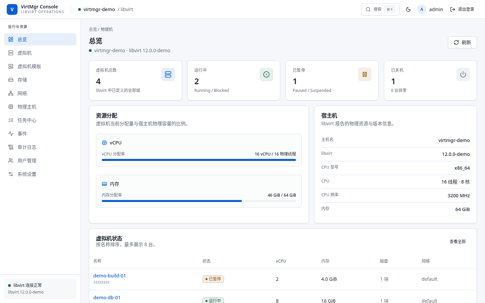
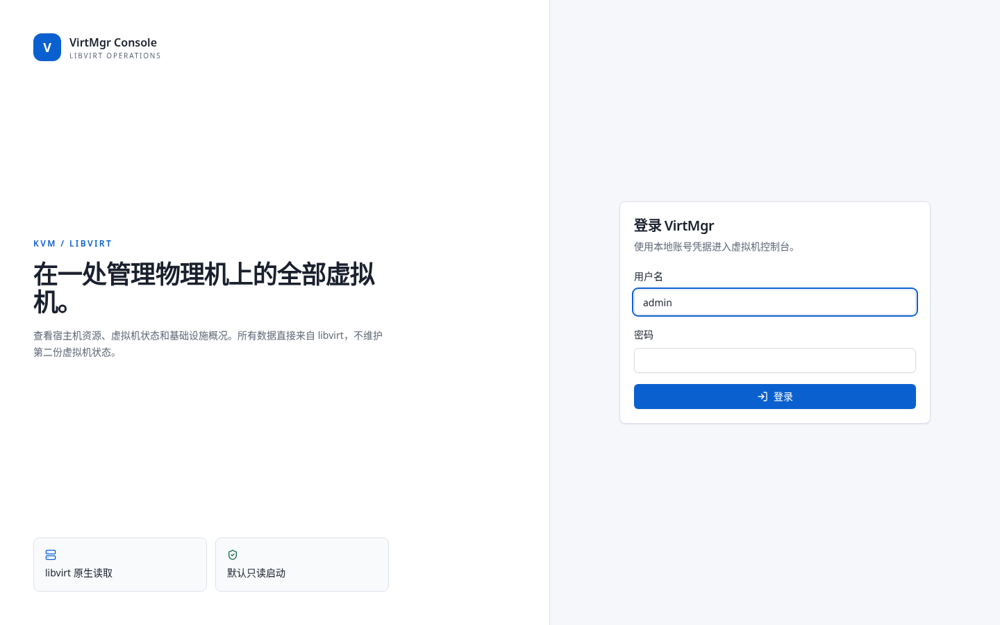
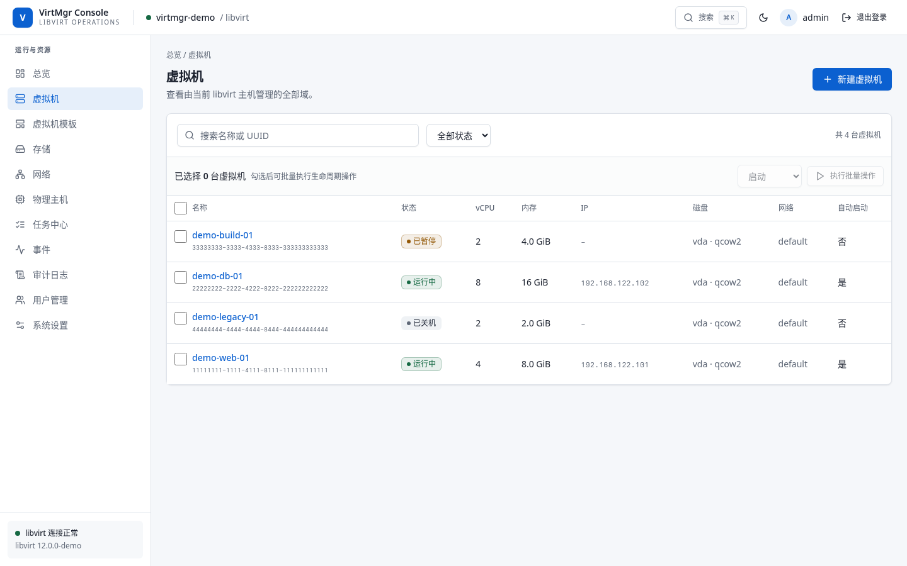
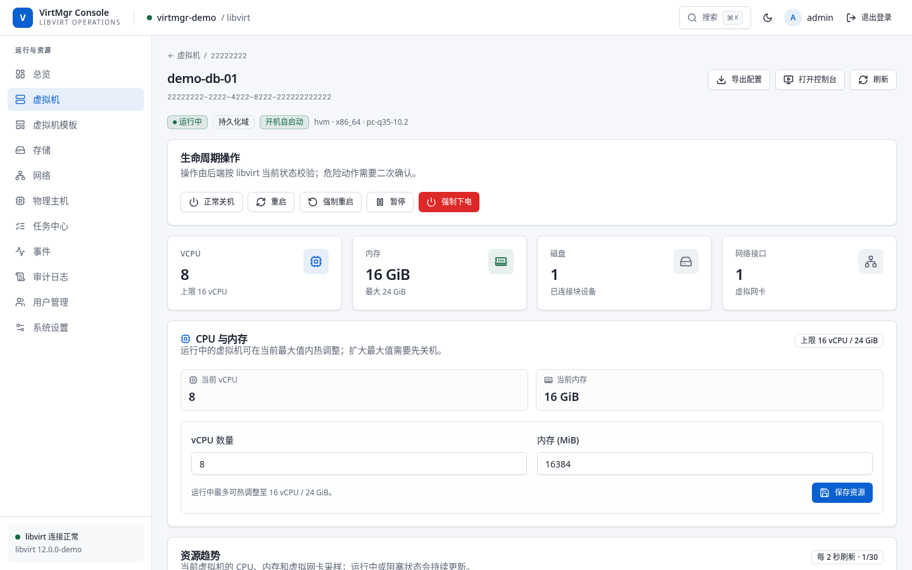
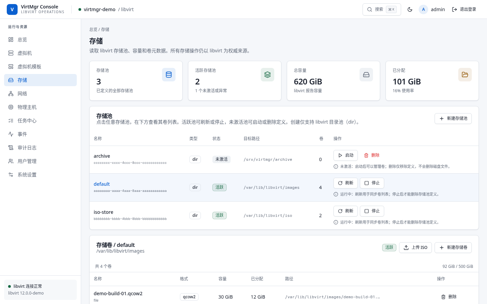
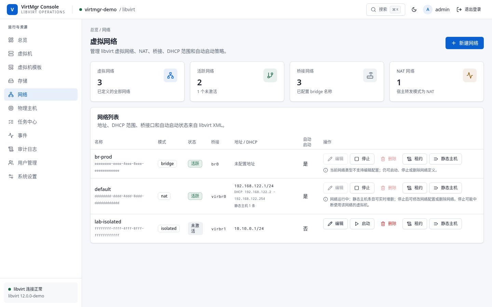

<div align="center">
  <h1>VirtMgr</h1>
  <p><strong>面向 KVM/libvirt 虚拟机的轻量级 Web 管理控制台。</strong></p>
  <p>VirtMgr 在单个自托管 Web 应用中提供宿主机健康度、虚拟机生命周期、存储、网络、快照、图形与串口控制台、审计日志和长任务管理能力。</p>
  <p>
    <a href="#项目截图">项目截图</a> ·
    <a href="#功能一览">功能一览</a> ·
    <a href="#快速开始">快速开始</a> ·
    <a href="#配置项">配置项</a> ·
    <a href="#认证与权限">认证与权限</a> ·
    <a href="#开发与测试">开发与测试</a> ·
    <a href="README.md">English</a>
  </p>
  <p>
    <a href="LICENSE"></a>
    <a href="https://github.com/xuthus5/virtmgr/actions/workflows/release.yml"></a>
    <a href="https://github.com/xuthus5/virtmgr/releases/latest"></a>
    
    
  </p>
  
</div>

## VirtMgr 是什么

VirtMgr 是面向单台 KVM/libvirt 宿主机的自托管管理控制台。它适用于家庭实验室、单机私有云，以及希望用浏览器替代重复 `virsh` 操作的运维场景。

虚拟机、存储池、网络、快照和宿主机资源的唯一事实来源始终是 libvirt。SQLite 保存本地用户、会话、虚拟机模板、定时快照策略、任务、运行时设置、审计记录，以及压缩后的持久域 XML 版本历史，不额外维护一份虚拟机运行状态。

前端通过 `go:embed` 打包进 Go 二进制，生产部署不需要单独运行 Web 服务器。VirtMgr 可直接连接本机 libvirt Socket，支持原生 HTTPS 或由反向代理终止 TLS，并以 systemd 服务运行。

## 项目截图

以下截图均来自内置 demo 后端，不包含真实宿主机信息。

| 登录页 | 总览 |
|---|---|
|  |  |

| 虚拟机列表 | 虚拟机详情 |
|---|---|
|  |  |

| 存储池与存储卷 | 虚拟网络 |
|---|---|
|  |  |

## 功能一览

| 模块 | 主要能力 |
|---|---|
| 总览 | 宿主机 CPU、内存、libvirt 版本、虚拟机数量、资源分配率、异常提醒和近期虚拟机状态 |
| 虚拟机 | 搜索和筛选域；按状态、标签、负责人筛选，本地保存筛选并收藏常用虚拟机；查看状态、vCPU、内存、磁盘、网络、IP 和自动启动；支持单台与批量生命周期操作 |
| 创建虚拟机 | 宿主机架构与机型能力探测、BIOS/UEFI、Secure Boot、已有磁盘或手工路径、从已登记镜像全量克隆或同池 qcow2 链接克隆、磁盘总线（virtio/SATA/SCSI）、网卡型号（virtio/e1000）、启动顺序、网络选择、ISO、自动启动，以及支持 user-data、network-config、vendor-data 的 Cloud-init seed ISO |
| 导入虚拟机 | 从活跃存储池选择或上传 RAW/QCOW2 系统盘或 ISO 安装介质；系统盘复制为独立卷，ISO 则新建空白 QCOW2 系统盘并以光盘优先启动，同时保留来源卷 |
| 虚拟机详情 | 标签/备注/负责人、硬件摘要、CPU/内存/网络/磁盘吞吐与 IOPS 实时趋势、历史指标、分网卡吞吐、磁盘、网卡、结构化 Guest Agent 信息与受控动作、Cloud-init 执行状态与日志尾部诊断、文件/密码/SSH/进程管理、期望状态健康历史、快照和域 XML |
| Web 控制台 | 页面内嵌或独立窗口打开 noVNC / xterm.js 控制台，支持图形与串口切换、Cockpit 风格组合键、缩放、断开重连、全屏和分离窗口；会话均通过一次性 token 与服务端 WebSocket 代理 |
| 虚拟机操作 | 启动、正常关机、重启、强制重启、暂停、恢复、强制下电、删除、克隆、导入、冷备份与在线一致性备份、自动启动、CPU/内存调整、磁盘扩容与跨池迁移，以及数据磁盘和网卡热插拔；同一虚拟机/存储卷的数据面操作互斥，异常退出后启动时自动恢复或标记人工处理 |
| 域 XML | 使用 CodeMirror 查看 live 或持久配置；管理员可在可写模式中校验并编辑持久配置 |
| 配置版本历史 | 配置变更和外部 libvirt 修改后自动归档持久域 XML；支持对比、固定、下载和回滚到早期定义 |
| 快照 | 创建、回滚、删除快照，并按固定间隔或每日时刻和保留策略配置定时快照 |
| 备份中心 | 集中管理冷备份和运行中虚拟机在线备份、Guest Agent 静默、一致性/vTPM 状态、备份 ZIP 包导出/导入、恢复为新虚拟机、固定间隔/每日计划、保留清理、固定保留、失败重试和任务 SSE 状态 |
| 镜像库 | 登记已有 qcow2/raw 卷及 OS 元数据；按需刷新容量和 SHA-256；模板可绑定镜像；从镜像全量克隆，或对同存储池 qcow2 镜像创建链接克隆；移除登记不会删除底层卷 |
| 存储 | 管理目录型存储池；启动、停止、刷新和删除定义；创建 qcow2/raw 卷；流式上传 ISO、qcow2 和 raw 镜像；阻止删除仍在使用的卷 |
| 网络 | NAT、隔离和外部桥接网络；IPv4-only、双栈和 IPv6-only 管理型网络；DHCP、SLAAC、有状态 DHCPv6、NAT66、网络 MTU、DNS 转发与静态 A/AAAA 记录；NAT 网络 IPv4/IPv6 TCP/UDP 入站端口转发、宿主机网桥发现、实时租约、IPv4/IPv6 静态主机及 CSV 批量导入/导出、网络诊断，以及创建、编辑、启停和删除 |
| 主机设备 | 展示 PCI、USB、网络、块和 DRM 设备，并支持 PCI/USB 设备直通与移除 |
| 可观测性 | SSE 实时事件与任务状态、任务失败重试、宿主机和运行中 VM 的 7 天历史指标、Prometheus `/metrics`、CPU/内存阈值 Webhook 告警、结构化日志和健康检查 |
| 安全 | 本地账号、Argon2id 密码、自助改密、管理员重置密码与会话撤销、带作用域且可撤销的 Bearer API Token、OpenAPI 3.1、HttpOnly/SameSite Cookie、CSRF 防护、角色权限、全局只读模式、可筛选/导出/按保留期清理的审计、CSP 和安全响应头 |
| 系统管理 | 版本/提交/构建时间、项目说明与稳定版本更新检查、SQLite 在线导出/恢复、审计保留期和全局只读设置 |
| 使用体验 | 响应式布局、固定且可折叠的侧边导航、明暗主题、键盘友好的全局搜索、本地保存的列表筛选与收藏、可访问对话框和危险操作二次确认 |
| 虚拟机模板 | 复用虚拟机规格、可选镜像绑定、固件/网络默认值和可交互 Cloud-init 默认配置（软件包、启动命令、区域、sudo/SSH 用户），不包含实例名称和磁盘路径 |

## 架构

```text
浏览器
  │ HTTPS
  ▼
React + TypeScript + Vite
  │ REST / SSE / WebSocket
  ▼
Go HTTP 服务与领域模块
  ├── libvirt Go binding ──► libvirtd / QEMU-KVM
  ├── modernc.org/sqlite ──► 用户、会话、任务、审计、模板和策略
  └── libvirt 事件循环 ────► SSE 事件流
```

前端编译后嵌入 Go 二进制，生产环境无需单独部署静态资源。后端遵循 `http → app → domain` 的依赖方向，libvirt、SQLite、指标和任务等基础设施适配放在 `internal/platform` 下。

更完整的产品边界、数据模型、路由和安全设计见 [docs/architecture-design.md](docs/architecture-design.md)。

## 快速开始

### 前置条件

- 已启用 KVM/QEMU 和 libvirt 的 Linux 宿主机
- Go `1.27.4+`（包含标准库 `net/http` 的安全修复）
- Node.js `24+` 和 npm
- C 编译器、`pkg-config` 和 libvirt 开发头文件，因为 libvirt Go binding 使用 CGO
- 可通过 `qemu:///system` 访问 libvirt Socket，通常为 `/var/run/libvirt/libvirt-sock`

Fedora 系发行版的典型开发环境安装命令：

```bash
sudo dnf install -y gcc make pkg-config libvirt libvirt-devel qemu-kvm
sudo systemctl enable --now libvirtd
```

不同发行版的软件包名称可能不同。构建前请确认已安装 `libvirt-dev` 或 `libvirt-devel`、QEMU/KVM 以及 libvirt 服务。

### 从源码构建

```bash
git clone git@github.com:xuthus5/virtmgr.git
cd virtmgr

npm --prefix web ci
make build

./bin/virtmgr version
```

`make build` 会先构建 React 前端，再将其嵌入 Go 二进制，最终生成 `bin/virtmgr`。

### 运行 demo 后端

demo 模式使用内置的 libvirt 模拟后端，不需要正在运行的 libvirt 服务，仅用于界面验收和开发调试。

```bash
cat >/tmp/virtmgr-demo.yaml <<'EOF'
listen: 127.0.0.1:8443
libvirt_uri: qemu:///system
database_path: /tmp/virtmgr-demo.db
admin_username: admin
admin_password: change-this-password
read_only: false
demo_mode: true
EOF

./bin/virtmgr --config /tmp/virtmgr-demo.yaml
```

打开 <http://127.0.0.1:8443>，使用用户名 `admin` 和上面配置的密码登录。

### 前端开发

分别在两个终端启动 Go API 和 Vite 开发服务器：

```bash
cp deploy/server.yaml.example server.yaml
# 编辑 server.yaml，至少设置 admin_password 并按需调整 database_path
go run ./cmd/virtmgr --config ./server.yaml
```

```bash
cd web
npm run dev
```

Vite 在 <http://127.0.0.1:5173> 提供前端页面，并将 `/api`、`/healthz` 和 `/readyz` 代理到 `8443` 端口的 Go 服务。

## 使用 systemd 部署

### 1. 安装二进制和服务账号

```bash
sudo useradd --system --home /var/lib/virtmgr --shell /sbin/nologin --groups libvirt virtmgr
sudo install -d -o virtmgr -g virtmgr -m 0750 /var/lib/virtmgr
sudo install -d -o root -g virtmgr -m 0750 /etc/virtmgr

sudo install -m 0755 bin/virtmgr /usr/local/bin/virtmgr
sudo install -m 0640 -o root -g virtmgr deploy/server.yaml.example /etc/virtmgr/server.yaml
sudo install -m 0644 deploy/virtmgr.service /etc/systemd/system/virtmgr.service
```

如果服务账号已经存在，请调整 `useradd` 命令，不要重复创建。

### 2. 配置 server.yaml

编辑 `/etc/virtmgr/server.yaml`：

```yaml
listen: 127.0.0.1:8443
libvirt_uri: qemu:///system
database_path: /var/lib/virtmgr/virtmgr.db
host_name: virt-host-01
admin_username: admin
admin_password: replace-with-a-strong-password
session_ttl: 8h
cookie_secure: false
trusted_proxies:
  - 127.0.0.1/32
read_only: false
demo_mode: false
```

`admin_password` 仅在数据库中没有任何用户时使用。首次成功启动后，应删除该明文密码。配置文件包含管理员初始密码，应只允许 root 和 `virtmgr` 组读取。VirtMgr 默认读取 `/etc/virtmgr/server.yaml`，也可以通过 `--config` 指定其他路径；未知 YAML 字段会导致启动失败。

### 3. 启动并验证

```bash
sudo systemctl daemon-reload
sudo systemctl enable --now virtmgr
sudo systemctl status virtmgr --no-pager

curl -fsS http://127.0.0.1:8443/healthz
curl -fsS http://127.0.0.1:8443/readyz
```

查看实时日志：

```bash
sudo journalctl -u virtmgr -f
```

### HTTPS 与反向代理

VirtMgr 支持两种 HTTPS 部署方式：

**原生 TLS**

```yaml
listen: 0.0.0.0:8443
tls_cert_file: /etc/virtmgr/tls/fullchain.pem
tls_key_file: /etc/virtmgr/tls/privkey.pem
cookie_secure: true
```

证书和私钥必须同时配置。私钥文件应仅允许服务账号读取。

**由 nginx、Caddy 或隧道终止 TLS**

让 VirtMgr 继续监听 `127.0.0.1:8443`，反向代理全部应用路径，并为 Web VNC 保留 WebSocket Upgrade；浏览器通过 HTTPS 访问时，应设置 `cookie_secure: true`。依赖 `X-Forwarded-For` 或 `X-Real-IP` 前，必须将反向代理地址或 CIDR 配置到 `trusted_proxies`（例如 `127.0.0.1/32` 或 `10.0.0.0/8`）；不受信客户端无法伪造审计与限流使用的来源地址。HTTPS 部署的响应还会包含 `Strict-Transport-Security: max-age=31536000`。

控制台使用同源 `wss://` 连接。部分浏览器允许用户临时跳过自签名证书以打开 HTTPS 页面，却仍会拦截 WebSocket 握手，表现为控制台一直连接但服务端收不到 Upgrade 请求。生产环境应使用浏览器信任的证书和域名；不要依赖 IP 地址加自签名证书作为长期控制台入口。

**IPv6 管理面访问**

将 `listen` 设置为 `"[::]:8443"` 可监听 Linux 双栈通配地址。使用 `X-Forwarded-For` 或 `X-Real-IP` 时，应把反向代理的 IPv6 地址加入 `trusted_proxies`；如需限制管理面来源，可用 `management_allowed_networks` 配置 IPv4/IPv6 CIDR 白名单，该限制在受信代理地址解析之后执行。通过字面 IPv6 地址访问浏览器时，证书 SAN 必须包含当前地址；由于运营商分配的 IPv6 前缀可能变化，生产环境应优先使用稳定 DNS 名称和证书。启用白名单前务必保留当前管理入口所在的 IPv6 前缀，避免把管理员锁在系统外。原生 TLS 证书和私钥文件变化后会自动热重载，系统设置页会展示 SAN 不匹配、到期时间和热重载错误。客户机网络的 IPv6 转发和 NAT66 依赖宿主机 `net.ipv6.conf.all.forwarding` 与防火墙策略，NAT66 仅提供出站访问；暴露业务前请先使用网络诊断页确认，并在每个受支持发行版上运行 `scripts/ipv6-compat-check.sh`。已验证矩阵与剩余边界见 `docs/ipv6-commercial-readiness.md`，证书轮换和回滚见 `docs/tls-rotation-runbook.md`。

不要在没有 TLS、防火墙和强管理员密码的情况下，将可写模式的 VirtMgr 直接暴露到公网。

## 使用容器部署

仓库提供多阶段镜像和 Compose 示例。镜像以非特权用户运行，挂载宿主机 libvirt socket 和持久化数据卷。

```bash
cd deploy/docker
cp ../../deploy/server.yaml.example server.yaml
# 编辑 server.yaml，设置 admin_password、host_name 和可选的 TLS 路径
# 按需编辑 compose.yaml 中的 LIBVIRT_GID 默认值

# Docker Compose
docker compose up -d --build

# 或 Podman Compose
podman compose up -d --build
```

`LIBVIRT_GID` 应与宿主机 `/var/run/libvirt/libvirt-sock` 的组 ID 一致：`stat -c '%g' /var/run/libvirt/libvirt-sock`。如需原生 TLS，取消 Compose 中的证书挂载注释并在 `server.yaml` 设置 `tls_cert_file` / `tls_key_file`。如果备份或存储功能需要直接读写宿主机存储目录，请把这些目录以相同路径挂载进容器；不要使用 `--privileged`。

## 配置项

| `server.yaml` 字段 | 默认值 | 说明 |
|---|---|---|
| `listen` | `127.0.0.1:8443` | HTTP/HTTPS 监听地址 |
| `tls_cert_file` | 空 | 原生 TLS 的 PEM 证书链，必须与私钥同时配置 |
| `tls_key_file` | 空 | 原生 TLS 的 PEM 私钥，必须与证书同时配置 |
| `libvirt_uri` | `qemu:///system` | libvirt 连接 URI |
| `database_path` | `/var/lib/virtmgr/virtmgr.db` | SQLite 数据库路径 |
| `host_name` | 操作系统主机名 | 页面展示的被管理宿主机名称 |
| `admin_username` | `admin` | 用户表为空时创建的初始管理员用户名 |
| `admin_password` | 空 | 初始管理员密码，仅在首次启动时需要 |
| `session_ttl` | `8h` | 登录会话有效期，必须为正的 Go Duration |
| `cookie_secure` | `false` | 将会话 Cookie 标记为 `Secure`；HTTPS 部署应开启 |
| `trusted_proxies` | 空列表 | 允许提供 `X-Forwarded-For` 和 `X-Real-IP` 的反向代理 IP/CIDR 列表 |
| `management_allowed_networks` | 空列表 | 管理面来源 IP/CIDR 白名单，支持 IPv6；空列表表示不限制 |
| `read_only` | `false` | 初始全局只读状态；首次启动后以 SQLite 持久化值为准 |
| `demo_mode` | `false` | 使用 demo 后端，仅用于界面开发，生产环境禁止开启 |

修改数据库、libvirt 连接或 TLS 路径后需要重启服务。全局只读模式也可以在管理员设置页中动态切换，并会持久化到 SQLite。

## 认证与权限

VirtMgr 使用本地账号。密码通过 Argon2id 哈希，会话在 SQLite 中仅保存 token 哈希，浏览器只持有 `HttpOnly`、`SameSite=Strict` 的会话 Cookie。所有写请求还必须在 `X-CSRF-Token` 请求头中携带当前会话的 CSRF token。失败登录会按用户名和来源地址持久化限流，超限返回 `429 TOO_MANY_ATTEMPTS`；未知用户和禁用账号也执行相同成本的密码哈希，以降低账号枚举信号。

用户还可以在设置页创建带作用域的 Bearer API Token。`read` 仅允许安全方法，`write` 同时包含 `read`；Token 支持有效期和即时撤销，SQLite 只保存哈希，明文仅在创建时返回一次。Bearer 请求不使用浏览器 CSRF，但仍受 Token 作用域、角色、全局只读和审计约束；Token 认证客户端不能创建、列出或撤销 Token。

| 角色 | 读取 | 虚拟机生命周期与创建/克隆/备份 | 快照、存储、网络、模板 | 图形/串口控制台 | 编辑域 XML | 用户、设置、审计 |
|---|---:|---:|---:|---:|---:|---:|
| `viewer` | 是 | 否 | 否 | 否 | 否 | 否 |
| `operator` | 是 | 是 | 是 | 是 | 否 | 否 |
| `admin` | 是 | 是 | 是 | 是 | 是 | 是 |

无论角色如何，全局只读模式都会阻止所有基础设施写操作。只读资源查询、域 XML 查看、配置导出、指标和事件查询仍然可用。

管理员可以在 Web 页面中创建用户、修改角色、禁用账号、重置其他账号密码、查看并撤销登录会话、按时间或目标筛选并导出审计日志，以及切换持久化的全局只读设置。所有本地账号都可以通过顶部“账号安全”入口验证当前密码并修改自己的密码；改密成功后保留当前会话并撤销其他会话。

登录页提供“忘记密码”说明。VirtMgr 单机版不依赖邮件服务，忘记密码时请在宿主机上使用具有数据库文件访问权限的服务账号执行本地恢复命令：

```bash
sudo -u virtmgr /usr/local/bin/virtmgr reset-password --username admin --config /etc/virtmgr/server.yaml
```

命令会以隐藏输入方式要求确认新密码，撤销该账号的全部登录会话，并记录一条不包含密码内容的审计事件。Docker 部署应在容器所在宿主机进入容器后执行等价命令。

## 安全与操作语义

- **libvirt 是唯一事实来源。** VirtMgr 不保存第二份虚拟机清单；libvirt 不可用时页面会明确降级，而不是展示伪造状态。
- **危险操作必须确认。** 强制下电、强制重启、快照回滚、删除存储卷和删除虚拟机都有明确确认流程，部分删除操作要求输入资源名称。
- **长任务进入任务中心。** 存储卷上传、格式转换/跨池复制、链接克隆展平、克隆、磁盘跨池迁移、冷备份和在线备份都会展示进度、步骤、失败原因和关联资源。允许类型的任务可在安全检查点取消；取消是协作式的，可能保留中间文件等待清理。
- **镜像移除不等于删除磁盘。** 镜像库只登记已有 qcow2/raw 卷，刷新时按需计算 SHA-256；移除条目始终保留底层卷，被模板引用时会拒绝。创建虚拟机默认全量克隆；qcow2 镜像在同存储池内可选择链接克隆，基础卷仍被链接克隆引用时禁止删除。存储页可将空闲 qcow2/raw 卷转换为另一种格式并复制到其他活跃池，也可将空闲链接克隆展平为独立 qcow2 卷，源卷保留，虚拟机引用不会自动切换；关机/异常停止虚拟机可在磁盘列表显式跨池迁移数据盘并原子切换持久配置引用。跨池链接克隆仍不提供。
- **备份以新虚拟机方式恢复。** 备份包含持久域 XML、SHA-256 manifest 和可写文件磁盘，不包含内存状态。运行中虚拟机通过外部磁盘快照取得在线一致性副本，可选择 Guest Agent 静默；vTPM 配置会随 XML 保存，但 vTPM 状态不会保存。不支持原地覆盖恢复或内存状态恢复。
- **磁盘扩容分为宿主机和客户机两层。** VirtMgr 先扩展 qcow2/raw 虚拟磁盘；Guest Agent 已连接且声明能力时，还可对 Linux 上由直接块设备承载的非根 ext4/xfs 执行固定 `growpart` 和 `resize2fs`/`xfs_growfs`。根分区、LVM、Windows 和未连接 Agent 的客户机仍需在客户机内手工扩展。不支持缩容。
- **CPU 与内存调整受 libvirt 上限约束。** 运行中的虚拟机只能在其活动最大值内热调整；提高最大值通常需要先关机。
- **控制台由服务端代理。** VNC 与串口会话均使用短时、一次性 token，宿主机 VNC 端口不会直接暴露。控制台支持组合键、重连、全屏和独立窗口。
- **Cloud-init 内容不写入审计。** 审计仅记录是否启用、存储池和字节数，不保存用户数据正文。
- **XML 编辑受到严格限制。** 只有可写模式下的管理员才能更新持久配置；名称和 UUID 不可变，QEMU commandline 命名空间会被拒绝，保存前由 libvirt 完成语义校验。
- **配置回滚只恢复 XML。** 版本历史保存压缩后的持久定义，不包含磁盘、快照或运行内存。回滚仅限管理员，会校验当前 SHA-256 以避免覆盖并发修改，先自动归档当前配置；运行中的虚拟机需重启后生效。
- **Guest Agent 为可选组件并按能力授权。** 新建虚拟机默认挂载 QGA 通道，已有持久域只能在关机或异常停止时补齐。虚拟机详情顶部始终提供“修改客户机密码”入口并打开聚焦弹窗；即使 Agent 未连接也不会静默隐藏入口，而是显示安装/连接原因和恢复指引。Agent 关机、重启、时间同步、TRIM、静默快照、受限文件读写、密码重置、SSH 公钥、登录用户、SIGTERM/SIGKILL 进程操作、非根文件系统在线扩容和只读软件包/更新清单仅在客户机声明对应能力时开放。Linux 客户机还可读取 Cloud-init 执行状态、失败 systemd 服务、内核/系统错误、OOM 事件和固定日志尾部；这些诊断只执行固定路径的 `systemctl`/`journalctl` 查询，并限制条数和输出大小。软件包清单同样只读，使用固定 `dpkg-query`/`apt-get -s`、`rpm`、`dnf`/`yum` 或 `zypper` 查询，不执行安装、升级、卸载或软件源刷新。VirtMgr **不提供通用任意命令接口**：进程读取只调用固定路径的 `/bin/ps` 或 `/usr/bin/ps`，终止只调用固定路径的 `/bin/kill` 或 `/usr/bin/kill`。文件操作只允许绝对路径、单次最多 1 MiB、按 64 KiB 分块；密码和完整 SSH 公钥永不写入审计，仅保留指纹与数量。

## API

API 位于 `/api/v1`，使用 JSON。浏览器使用 Cookie，写操作还需要 `X-CSRF-Token`；自动化客户端可使用带 `read` 或 `write` 作用域的 Bearer API Token。OpenAPI 3.1 契约位于 `GET /api/v1/openapi.json`。

主要接口分组如下：

| 模块 | 示例 |
|---|---|
| 会话 | `POST /api/v1/session`、`GET /api/v1/session`、`DELETE /api/v1/session` |
| 自动化 | `GET/POST /api/v1/api-tokens`、`DELETE /api/v1/api-tokens/{id}`、`GET /api/v1/openapi.json` |
| 总览与宿主机 | `/api/v1/overview`、`/api/v1/host`、`/api/v1/host/devices`、`/api/v1/host/metrics` |
| 虚拟机 | `/api/v1/vms`、`/api/v1/vms/import`、`/api/v1/vms/{uuid}`、`/metrics`、`/xml`、`/config-versions`、`/snapshots`、`/guest-agent`、`/guest-agent/files`、`/guest-agent/password`、`/guest-agent/ssh-keys`、`/guest-agent/processes`、`/guest-agent/users`、`/guest-agent/policy`、`/guest-agent/health`、`/devices`、`/actions/{action}` |
| 虚拟机操作 | `/resources`、`/disks/{target}`、`/clone`、`/backups`、`/console-token`、`/console/send-key`、`/console`、`/serial-console`、`/export` |
| 备份中心 | `/api/v1/backups`、`/backups/{id}/verify`、`/backups/{id}/restore`、`/backup-schedules`、`/backup-repositories` |
| 存储 | `/api/v1/storage/pools`、`/volumes`、`/volumes/upload` |
| 镜像库 | `GET/POST /api/v1/images`、`GET/DELETE /api/v1/images/{id}`、`POST /api/v1/images/{id}/refresh` |
| 网络 | `/api/v1/networks`、`/networks/bridges`、`/leases`、`/hosts`、`/diagnostics`、`/actions/{action}` |
| 系统 | `/api/v1/events`、`/events/stream`、`/tasks`、`/templates`、`/audit-events`、`/audit-events/export`、`/users`、`/users/me/password`、`/users/{id}/sessions`、`/settings`、`/system/info`、`/system/update` |

允许类型的任务可在安全检查点通过 `POST /api/v1/tasks/{id}/cancel` 取消。

完整路由和行为说明见 [docs/architecture-design.md](docs/architecture-design.md)。

## 开发与测试

```bash
# 后端与前端单元测试
make test

# Go 静态检查
make vet

# 构建二进制和嵌入前端
make build

# 严格串行的 Playwright E2E（只读和可写 demo 两套场景）
make e2e
```

Playwright 配置有意固定为串行：`workers: 1`、`fullyParallel: false`、`maxFailures: 1`。不要通过命令行提高并发。测试使用独立端口和临时 SQLite 数据库。

真实 libvirt 集成测试需要显式开启，并要求宿主机可访问 `qemu:///system`：

```bash
VIRTMGR_TEST_REAL_LIBVIRT=1 go test ./internal/platform/libvirt -run TestRealLibvirtReadOnly -v
VIRTMGR_TEST_REAL_LIBVIRT=1 go test ./internal/platform/libvirt -run TestRealLibvirtCloudInitCreate -v
```

### 发布产物

发布 GitHub Release 时会触发 [`.github/workflows/release.yml`](.github/workflows/release.yml)，为 Linux `amd64` 和 `arm64` 构建二进制、生成 tar 包和 `checksums.txt`，并附加到 Release。

## 项目结构

```text
cmd/virtmgr/              程序入口
internal/bootstrap/       依赖装配、HTTP 路由、生命周期和安全响应头
internal/domain/          领域类型、校验和错误契约
internal/modules/         按业务模块拆分的 http/app 层
internal/platform/        libvirt、SQLite、认证上下文、指标、任务和配置
web/                      React + TypeScript + Vite + Tailwind 前端
deploy/                   systemd、容器镜像、Compose 和 server.yaml 示例
docs/                     架构文档与项目截图
scripts/                  本地开发和 E2E 辅助脚本
.github/workflows/        发布二进制流水线
```

## 兼容性与边界

- 一个 VirtMgr 实例管理一个 libvirt 端点。跨宿主机调度、迁移和多集群清单尚未实现。
- 运行环境为 Linux + KVM/QEMU + libvirt Go binding；构建需要 CGO 和 libvirt 开发头文件。
- 图形控制台当前仅支持 VNC，不支持 SPICE。串口控制台支持 libvirt PTY 设备，同一串口设备同时只允许一个交互会话。
- 容器部署需要挂载宿主机 libvirt socket，并使用与 socket 组 ID 匹配的补充组；需要直接访问存储路径时还应以相同路径挂载对应目录。
- 备份支持持久虚拟机的冷全量备份，以及运行中虚拟机的在线全量备份；在线模式仅支持文件型源存储池，使用外部磁盘快照和活动 block commit。已完成备份可下载为自包含 ZIP 包并重新导入备份目录，导入会生成新的备份 ID 和产物名称。增量备份、原地覆盖恢复、跨宿主机复制和自动内容校验未实现。
- 虚拟机导入支持活跃存储池中的 QCOW2/RAW 系统盘和 ISO 安装介质；ISO 模式会创建空白系统盘并保留 ISO 作为只读光驱。导入不直接接受 OVA/OVF、VMDK 和 VHDX；已有空闲 qcow2/raw 卷可在存储页转换格式或复制到其他池。
- 镜像库支持上传 qcow2/raw、从镜像全量克隆，以及同存储池 qcow2 镜像的链接克隆；存储页支持空闲卷 qcow2/raw 格式转换、跨池复制和链接克隆展平。关机/异常停止虚拟机的数据盘可跨池迁移并自动切换持久域引用，但跨池链接克隆尚未实现。
- 创建和导入虚拟机时，架构与机型来自宿主机 libvirt 能力探测；可显式选择架构和机型，并校验 UEFI、Secure Boot 与镜像架构兼容性。未指定时保持 x86_64/BIOS 兼容默认，ARM64 宿主默认使用 `virt` 机型。
- 自动备份校验和夏令时特殊处理不在当前范围；每日调度使用服务端本地时区。
- “关于”页面展示当前构建信息、产品定位和能力边界。更新检查由服务器访问 GitHub Releases 并缓存结果，只提示稳定版本、发布时间和发布说明，不自动下载、安装或重启服务。
- 管理型 NAT/隔离网络支持 IPv4-only、双栈和 IPv6-only。IPv4 使用 DHCP；IPv6 支持 SLAAC（`/64`）和有状态 DHCPv6（`/64` 至 `/124`），NAT 双栈网络默认启用 NAT66。支持 DNS 转发、DHCPv6 DUID/Client ID 静态主机、网络诊断及 CSV 批量导入/导出。NAT 网络支持 IPv4/IPv6 TCP/UDP 入站端口转发，通过受控 `virtmgr_pf` nftables 表实现，运行服务需要 `CAP_NET_ADMIN`。外部桥接网络接入宿主机已有 Linux 网桥，并使用上游网络提供的地址/DHCP；单块网卡可设置入站/出站带宽 QoS。VirtMgr 不创建宿主机网桥，也不管理 VLAN、bond、OVS、SR-IOV、显式 RA 参数/前缀委派或安全组。
- 告警仅支持现有规则级 Webhook；不提供通知中心、SMTP、Slack/Teams、PagerDuty、通知静默或升级策略。
- 虚拟机磁盘缩容、任意宿主机 Shell 执行和不受限制的 libvirt API 代理不在当前范围内。
- 建议使用较新的 Chrome、Edge、Firefox 或 Safari。

## 文档

- [架构设计](docs/architecture-design.md)——产品边界、架构、数据模型、路由、安全和部署细节
- [产品差距分析](docs/product-gap-analysis.md)——与主流管理工具的差异、单机精品路线和已实施能力状态
- [备份与恢复方案](docs/backup-design.md)——冷备份、在线一致性备份、恢复、调度和保留策略
- [发布流水线](.github/workflows/release.yml)——amd64/arm64 二进制构建与 Release 附件
- [server.yaml 示例](deploy/server.yaml.example)——生产环境配置模板
- [systemd 单元文件](deploy/virtmgr.service)——加固后的服务定义
- [容器镜像](deploy/docker/Dockerfile) 与 [Compose 示例](deploy/docker/compose.yaml)——libvirt socket 和非特权运行

## 许可证

本项目使用 [Apache License 2.0](LICENSE) 开源协议。

你可以在遵守该协议条款的前提下使用、修改和分发本项目。除非适用法律要求或经书面同意，按本协议分发的软件均按“原样”提供，不附带任何明示或暗示的保证。
